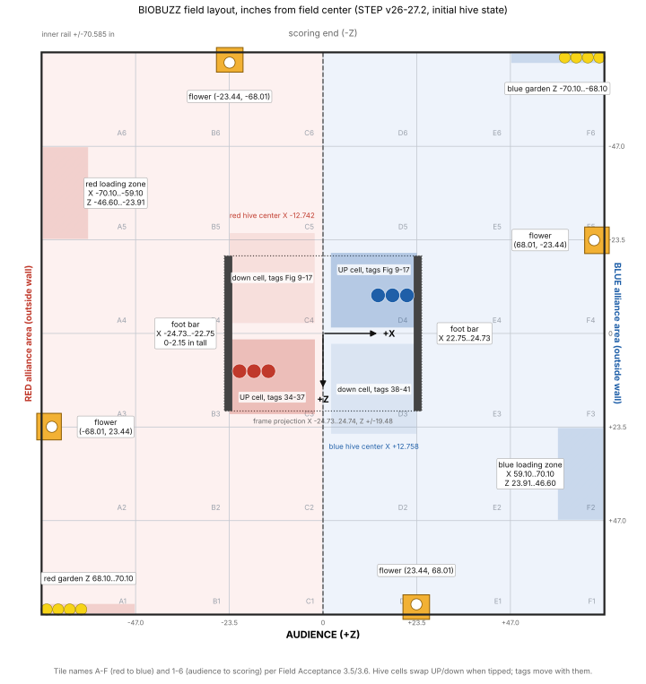

# BIOBUZZ field layout for programming

Permanent field geometry for 2026-27 BIOBUZZ, in one coordinate frame, for code
that needs positions: autonomous routes, localization, aiming and collision
checks. Nothing here depends on our robot; robot behavior is in
[POLLEN_ROBOT_BEHAVIOR.md](POLLEN_ROBOT_BEHAVIOR.md).

Positions come from the official field CAD (STEP v26-27.2), read on October 23,
2026; sizes and tolerances come from the Competition Manual and the Field
Acceptance Checklist. CAD values are **nominal**: the manual's general
tolerance is +/-1 in (§9.1), so measure anything a route depends on.



`python3 tools/draw-pollen-field-layout.py` (matplotlib) redraws the diagram.

## Coordinates

| Item | Convention |
| --- | --- |
| Units | inches; CAD metres / 0.0254 |
| Origin | field center, on the tile top surface |
| +X | toward the blue alliance; red half is X < 0 |
| +Z | toward the audience; scoring end is Z < 0 |
| +Y | up; tile top surface is Y = 0 |
| Diagrams | match view: audience at the bottom, red on the left |
| Robot travel angle (Pollen code) | 0 = robot forward, + = robot left, - = robot right; see the code README |
| Blue from red | rotate 180 degrees: (X, Z) -> (-X, -Z), headings included |

To use a corner origin instead (for example a library that puts (0, 0) in a
field corner), translate and flip explicitly and test it on the robot. From the
red/audience inner corner, with x toward blue and y toward the scoring end:
`x = X + 70.585`, `y = 70.585 - Z`. Check your library's own convention; this
document does not assume one.

## Perimeter and tiles

| Item | Value | Source |
| --- | --- | --- |
| Field interior | approximately 144 x 144 in | Manual §9.2 |
| Inner face of the rails | X, Z = +/-70.585 (span 141.17 in) | CAD |
| Bottom rail | Y -0.589 to 0.541 (top 0.54 in above the tiles) | CAD |
| Top rail | Y 10.514 to 11.644 | CAD |
| Side glass | Y 0.09 to 10.97, plane at +/-70.674 (0.089 in outboard of the rails) | CAD |
| Tiles | 36 soft tiles, approximately 24 x 24 x 0.59 in | Manual §9.2 |
| Tile seams | X and Z = 0, +/-23.50, +/-47.00 (CAD tile pitch 23.50 in) | CAD |

A robot part between 0.54 in and 10.51 in above the tiles touches the glass,
0.089 in farther out than a part at rail height. Starting "against the wall"
therefore depends on bumper height.

Tile names: columns **A-F from red to blue**, rows **1-6 from audience to
scoring** (A1 = red/audience corner, F6 = blue/scoring corner). Red's half is
columns A-C (G304.A). Seam numbers 1-5 run along Z from the audience: seam 1 at
Z +47.0, seam 3 at Z 0, seam 5 at Z -47.0. The letters come from Field
Acceptance 3.5-3.6 and G304.A; the seam numbering is derived by matching
acceptance items 3.2-3.3 to the CAD tape.

## Zones

| Zone | X (in) | Z (in) | Tile | Size and checks |
| --- | --- | --- | --- | --- |
| Red loading zone | -70.101 to -59.101 | -46.599 to -23.907 | A5 | 22.69 x 11.0 in tape outer edges; manual ~23 x 11 in; 11 +/-0.125 in (Acceptance 3.4); between seams 4 and 5 +/-0.125 in (3.2) |
| Blue loading zone | +59.101 to +70.101 | +23.907 to +46.599 | F2 | mirror of red; seams 1 and 2 (3.3) |
| Red garden | -70.101 to -47.409 | +68.101 to +70.101 | A1, audience edge | 22.69 x 2.0 in; manual ~23 x 2 in; full tile width (3.5, 3.7) |
| Blue garden | +47.409 to +70.101 | -70.101 to -68.101 | F6, scoring edge | mirror of red (3.6) |
| Red alliance area | -125.65 to -71.65 | -48.41 to +48.41 | outside the field | 54 x 96.8 in; manual ~97 x 54 in |
| Blue alliance area | +71.65 to +125.65 | -48.41 to +48.41 | outside the field | mirror of red |

Tape lines are part of a loading zone (§9.3). In the CAD the tape's wall-side
edge sits 0.484 in inside the rail plane and its inboard edge 11.484 in out;
Acceptance 3.4 says 11 in. Our route checker treats X <= -59.585 (11 in from
the rail) as the safe inboard limit for red parking.

## Frame and hives

| Item | Value | Source |
| --- | --- | --- |
| Frame base | 49.46 in wide x 38.95 in deep | Manual §9.6.1 |
| Frame projection | X -24.729 to +24.742, Z -19.476 to +19.476, top Y 44.31 | CAD |
| Foot bars (floor obstacle) | X -24.73 to -22.75 and +22.75 to +24.73; Z -19.47 to +19.47; Y 0 to 2.15 | CAD |
| Foot bar placement | each end at the fourth tile tooth from the tile junction, +/-0.50 in | Acceptance 1.8 |
| Under-tile bars | Y -0.74 to -0.63, below the tiles; not an obstacle | CAD |
| Hive pivot height | 43.95 in above the tiles | Manual §9.6.1 |
| Hive centers | red X -12.742, blue X +12.758 | CAD |
| Cell opening | approximately 20 in wide x 14 in tall, 12 in deep; cells ~18.8 in apart | Manual §9.6.2 |
| Upright cell, bottom of opening | 53.5 +/-0.50 in above the tiles | Acceptance 1.13 |
| Lowest hive point | Y 30.65 (bottom of a downward cell) | CAD |
| Collision envelope, both tip states | X -23.354 to +23.354, Z -25.071 to +25.071 | CAD union |

The foot bars, not the hives, block a robot on the floor. A straight diagonal
from the middle of an end wall to the loading zone crosses a foot bar; see
[POLLEN_FIELD_ROUTES.md](POLLEN_FIELD_ROUTES.md).

Cells in the CAD's initial state, which matches the event setup: each alliance's
upward cell holds its 3 staged nectar.

| Cell | State at match start | X (in) | Y (in) | Z (in) |
| --- | --- | --- | --- | --- |
| Red, audience side | UP | -23.27 to -2.21 | 43.95 to 65.93 | +1.67 to +20.06 |
| Red, scoring side | down | -23.27 to -2.21 | 30.65 to 50.49 | -25.07 to -2.72 |
| Blue, audience side | down | +2.16 to +23.35 | 30.65 to 50.49 | +2.72 to +25.07 |
| Blue, scoring side | UP | +2.16 to +23.35 | 43.95 to 65.93 | -20.06 to -1.67 |

A tip swaps the states: the hive mirrors about Z = 0, and the other cell becomes
the upward one. Our team estimate for the horizontal center of an upright
cell's opening is Z = +/-15.7 in, from the CAD front rib; it is not a surveyed
target. Field calibration: 3 nectar + 2 pollen placed in an upright cell must
not tip it and one more tossed pollen must; likewise 7 pollen, then one more
(Acceptance 2.3-2.6). These are field checks, not a guaranteed count for
launched pieces.

## Flowers

Four flowers sit on wall-panel joints, two in each alliance's half.

| Flower | Axis (X, Z) | Envelope X (in) | Envelope Z (in) |
| --- | --- | --- | --- |
| Red scoring wall | (-23.44, -68.01) | -26.727 to -20.058 | -71.794 to -65.630 |
| Red side wall | (-68.01, +23.44) | -71.794 to -65.630 | +20.058 to +26.727 |
| Blue audience wall | (+23.44, +68.01) | +20.058 to +26.727 | +65.630 to +71.794 |
| Blue side wall | (+68.01, -23.44) | +65.630 to +71.794 | -26.727 to -20.058 |

Each envelope is 6.669 in along its wall and reaches 4.955 in into the field
from the rail plane. The axis is the center of the starting pollen stack.

Heights, from the red scoring-wall flower in CAD (the other three are the same
part):

| Part | Y (in) | Manual / acceptance |
| --- | --- | --- |
| Bottom ring | -0.20 to 0.35 | ~0.4 in tall, 2.79 in hole (§9.7); rests on the tiles (Acceptance 1.6) |
| Retrieval opening | 0.35 to 3.90 | ~3.55 in tall x 3.57 in deep (§9.7) |
| Middle ring | 3.90 to 5.25 | |
| Scoring volume (between middle and top rings) | about 5.25 to 20.25 | Game Details §10.5.2 |
| Wall bracket, on top of the rail | 11.44 to 11.84 | widest part along the wall (X -26.727 to -20.058) |
| Top ring and opening | 20.25 to 21.40 | ~4 in opening, 21.5 +/-0.25 in above the tiles (Acceptance 1.7) |
| Backstop | 22.40 to 22.65 | 1.25 in tall (§9.7) |

Below the wall bracket, the flower body ends near X -20.45 on the scoring wall:
a robot part lower than about 11.4 in has roughly 0.4 in more room beside the
flower than the envelope table shows.

## AprilTags

- Family 36h11, 3.25 in square, a cluster of four tags on the bottom of each
  cell (§9.9).
- Audience-side cells carry IDs 34-41 in order (Acceptance 1.11). The manual
  text puts 38-41 on the blue audience cell, which leaves **34-37 on the red
  audience cell** (derived). Scoring-side cell IDs were not legible in the text
  version of the manual: read Figure 9-17, or log them with the camera.
- Tags ride on the hive and move when it tips. Use them for relative aiming,
  not as fixed field landmarks.

| Cluster sticker, initial state | X (in) | Y (in) | Z (in) |
| --- | --- | --- | --- |
| Red audience cell (UP), 34-37 | -21.24 to -4.24 | 48.41 to 50.92 | +10.72 to +15.06 |
| Red scoring cell (down) | -21.24 to -4.24 | 34.39 to 36.90 | -13.56 to -9.23 |
| Blue audience cell (down), 38-41 | +4.26 to +21.26 | 34.39 to 36.90 | +9.23 to +13.56 |
| Blue scoring cell (UP) | +4.26 to +21.26 | 48.41 to 50.92 | -15.06 to -10.72 |

These bounds cover a whole 4-tag sticker; per-tag poses are not derived here.

## Game pieces and where they start

| Piece | Size | Count | Starting positions |
| --- | --- | --- | --- |
| Pollen (yellow) | ~2.8 in ball | 40 | 4 stacked in each flower (Y 1.40, 4.29, 7.18, 10.07 on its axis; the bottom one sits in the retrieval opening); 4 in each garden (red at X -69.31, -66.42, -63.53, -60.64, Z +69.3; blue mirrored); 4 pre-loaded on each robot |
| Red nectar | ~3.6 in ball | 8 | 3 in the red UP cell (X -20.94, -17.32, -13.70; Z +9.47); 5 in the red alliance area |
| Blue nectar | ~3.6 in ball | 8 | 3 in the blue UP cell (X +13.81, +17.43, +21.05; Z -9.57); 5 in the blue alliance area |

Sizes and counts: Manual §9.8 and §10.3.1; pieces are not perfectly spherical.
Positions: CAD (it draws the 16 robot pre-loads outside the wall beside each
loading zone).

## Match facts that constrain programs

| Rule | What it means for code | Source |
| --- | --- | --- |
| AUTO 30 s, 8 s transition, TeleOp 2 min | Pollen code stops its own outputs at 27 s and plans for <26 s | Game Details §10.1, §10.4 |
| Start: touching the perimeter wall, fully on our half, not touching a flower or its scoring volume, not in the loading zone, exactly 4 pollen | Start poses in POLLEN_FIELD_ROUTES.md are built to these | Game Rules G304 |
| Alignment devices allowed for setup; only the robot may stay on the field | spacer gauges are fine, removed before the match | G302, G303.C |
| LEAVE (3, AUTO): no longer touching the perimeter wall at the end of AUTO | a parked robot must not touch the side wall | §10.5, §10.5.4 |
| PARK (5 AUTO, 5 end of match): at least partly in our loading zone | partial overlap is enough | §10.5.4 |
| Flower scoring: only by placing into the top, only in the last minute | ignore flowers in AUTO | §10.5.2 |

## Machine-readable features

Axis-aligned boxes in field inches, initial hive state. `y` is height; blank =
not used. Copy this block into code or a test rather than retyping numbers.

```csv
feature,x_min,x_max,z_min,z_max,y_min,y_max,source
rail_inner_plane,-70.585,70.585,-70.585,70.585,,,CAD
bottom_rail,,,,,-0.589,0.541,CAD
top_rail,,,,,10.514,11.644,CAD
red_loading_zone,-70.101,-59.101,-46.599,-23.907,,,CAD tape
blue_loading_zone,59.101,70.101,23.907,46.599,,,CAD tape
red_parking_safe_inboard_limit,-70.101,-59.585,-46.599,-23.907,,,CAD tape + Acceptance 3.4
red_garden,-70.101,-47.409,68.101,70.101,,,CAD tape
blue_garden,47.409,70.101,-70.101,-68.101,,,CAD tape
frame_projection,-24.729,24.742,-19.476,19.476,0,44.31,CAD
red_foot_bar,-24.73,-22.75,-19.47,19.47,0,2.15,CAD
blue_foot_bar,22.75,24.73,-19.47,19.47,0,2.15,CAD
hive_union_both_states,-23.354,23.354,-25.071,25.071,30.65,65.93,CAD
red_cell_audience_up,-23.27,-2.21,1.67,20.06,43.95,65.93,CAD initial state
red_cell_scoring_down,-23.27,-2.21,-25.07,-2.72,30.65,50.49,CAD initial state
blue_cell_audience_down,2.16,23.35,2.72,25.07,30.65,50.49,CAD initial state
blue_cell_scoring_up,2.16,23.35,-20.06,-1.67,43.95,65.93,CAD initial state
flower_red_scoring_wall,-26.727,-20.058,-71.794,-65.630,-0.65,22.78,CAD
flower_red_side_wall,-71.794,-65.630,20.058,26.727,-0.65,22.78,CAD
flower_blue_audience_wall,20.058,26.727,65.630,71.794,-0.65,22.78,CAD
flower_blue_side_wall,65.630,71.794,-26.727,-20.058,-0.65,22.78,CAD
flower_scoring_volume,,,,,5.25,20.25,CAD rings + Game Details 10.5.2
tag_cluster_red_audience_34_37,-21.24,-4.24,10.72,15.06,48.41,50.92,CAD initial state
tag_cluster_blue_audience_38_41,4.26,21.26,9.23,13.56,34.39,36.90,CAD initial state
```

## Known gaps between sources

- The CAD rail span (141.17 in) is smaller than the manual's ~144 in, and the
  CAD tape edge (11.484 in from the rail) differs from Acceptance 3.4 (11 in).
  These were not averaged; measure the event field.
- CAD bounds are extracted vertex minima and maxima, not exact curved-surface
  extremes. Treat them as close to, not exactly, the real surfaces.
- The CAD hive centers differ by 0.017 in between alliances, below setup
  tolerance.
- Raw extraction (all 993 CAD parts, the script, file hashes) is in the team's
  research handoff, outside this repository.

## Sources

- [FIRST field resources](https://ftc-resources.firstinspires.org/ftc/field) and
  [official field CAD, STEP v26-27.2](https://ftc-resources.firstinspires.org/ftc/field/field-cad-step)
- [Competition Manual §9 Arena, TU06](https://ftc-resources.firstinspires.org/ftc/game/manual-09):
  §9.1 tolerance, §9.2 field and tiles, §9.3 zones, §9.6 frame and hive,
  §9.7 flowers, §9.8 game pieces, §9.9 AprilTags
- [Competition Manual §10 Game Details, TU05](https://ftc-resources.firstinspires.org/ftc/game/manual-10):
  §10.1 and §10.4 match timing, §10.3.1 piece counts, §10.5 scoring
- [Competition Manual §11 Game Rules, TU06](https://ftc-resources.firstinspires.org/ftc/game/manual-11):
  G302-G304 setup
- [Field Acceptance Checklist 26-27.2](https://ftc-resources.firstinspires.org/ftc/field/field-check):
  items 1.6-1.8, 1.11, 1.13, 2.3-2.6, 3.2-3.8
