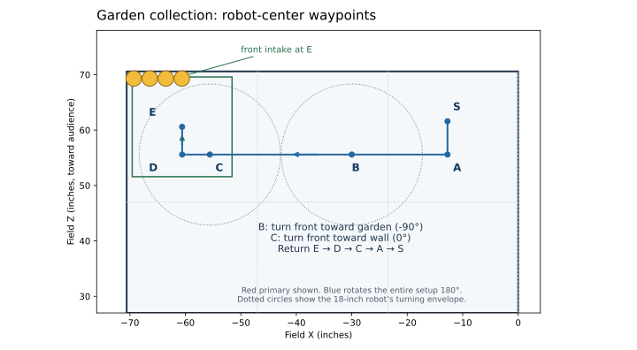

# Limelight hive readiness and garden autonomous

Build **pollen-hive-v2**. Experimental. The existing match autos keep their behavior. The new
entries are in the **Pollen Hive** group. Printable sheet:
[drive-team/4-hive-practice.md](drive-team/4-hive-practice.md) ([PDF](drive-team/print/4-hive-practice.pdf)).

## What is implemented

| Driver Hub entry | Purpose |
| --- | --- |
| TEST Hive camera (NO MOTORS) | Camera calibration and checks. Never maps a motor. Square measures, Cross saves. |
| EXPERIMENTAL Hive Primary + Garden | Shoot when our cell is UP, stop flywheel, collect with the front intake, return, wait/shoot again, park. |
| EXPERIMENTAL Hive Secondary | Wait for our cell to be UP, feed only while it stays UP, park. |

**Normal use: place the robot, pick the auto, INIT, START.** The defaults are meant to be right:
Execution LIVE, Side AUTO (the robot finds its own cell, so its alliance, from the tags behind it),
and the route and camera numbers in `PollenHiveSettings`.

**Every number can be changed in INIT,** and anything that differs from its default is flagged.

## The INIT menu: try it, keep it, make it the default

| Button (during INIT) | Does |
| --- | --- |
| D-pad up / down | Row (36 rows: 28 for the auto, 8 for the camera) |
| LB / RB | Jump 5 rows |
| D-pad left / right | Change the value |
| Triangle | This row back to its default |
| Circle | Every row back to its default |
| Square | Save the changes on the Control Hub |

How changes show:
- **Top of the screen:** `SETTINGS: all defaults`, or `*** 2 CHANGED FROM DEFAULT: Side=RED, Launcher ticks/s=1200 ***`.
- **Unsaved edits:** an `UNSAVED` line appears.
- **On the changed row itself:** `Launcher ticks/s: 1200   ** CHANGED (default 1180) **`, plus `NOT SAVED` until Square.
- **In the robot log:** every START line lists the changed rows.

The Hub keeps **only the changes**, in `FIRST/pollen-hive` (normally `/sdcard/FIRST/pollen-hive`):
- `primary.properties` and `secondary.properties`: one for each auto.
- `camera.properties`: shared by both autos and TEST Hive camera.

An empty file means all defaults. Changes stay until you reset the row (Triangle, then Square).

**Execution is never saved.** Every INIT starts at LIVE, so a DRY test from yesterday can't make a
match auto sit still. Setting DRY or DRIVE shows `CHANGED ... this run only`.

**Side**:
- `AUTO (detect)` (default): from the primary start our cell is red 34-37 or blue 42-45, from the
  secondary start red 30-33 or blue 38-41, whichever is straight behind the robot.
- `RED` / `BLUE`: forces that alliance's cell from the start. Tags of that cell more than 12.5 in to
  the side are ignored even then, so a forced side on the wrong start never shoots.

**Make proven changes the new defaults** (this is how field results get back into the code):

```bash
adb connect 192.168.43.1:5555
adb pull /sdcard/FIRST/pollen-hive ~/Desktop/pollen-hive
python3 tools/hive-promote-defaults.py ~/Desktop/pollen-hive          # shows what would change
python3 tools/hive-promote-defaults.py ~/Desktop/pollen-hive --write  # rewrites PollenHiveSettings.java
bash tools/test-pollen-sequence.sh
git commit -am "Hive defaults from practice <date>"
ftcgradle :TeamCode:installDebug
```

After the install, those rows match the defaults and stop showing CHANGED. The saved file only
matters again if someone changes a row. The tool:
- warns before promoting a forced RED/BLUE side, which would force that side in every match;
- never promotes Execution;
- skips names the code doesn't have.

## How the robot decides "our cell is UP"

`IsHiveReadyForShot` does three things every loop.

1. **Which cell is ours.** Each hive cell has four AprilTags with its own IDs (game manual 9.6):
   **30-33** red scoring side, **34-37** red audience side, **38-41** blue audience side,
   **42-45** blue scoring side. From the primary start our cell is 34 (red) or 42 (blue); from the
   secondary start 30 (red) or 38 (blue). With Side AUTO, our cell is whichever of the two is
   nearest straight behind the robot. From our start spots our own tags are at most about 10 in to
   the side and the other hive's at least about 16 in, and anything more than 12.5 in to the side is
   ignored. The first time one cell is nearest in 4 new frames in a row after START (with the robot
   settled at the shooting spot), it is locked for the rest of the run. During INIT the autos show
   what they see, so the drive team can check it says the right alliance. Secondary normally sees
   nothing in INIT, because its cell starts DOWN; it locks when the cell comes up. Side RED or
   BLUE fixes the cell from the start.
2. **How high the tags are.** The Limelight gives each tag's position from the lens in metres: x
   right, y down, z out of the lens ([Limelight camera space](https://docs.limelightvision.io/docs/docs-limelight/pipeline-apriltag/apriltag-coordinate-systems)).
   With the lens height and the camera's upward tilt:

       height above tiles = lensHeight + z*sin(tilt) - y*cos(tilt)

   The height doesn't depend on where the robot is or which way it points. That's why one
   calibration works at every start spot, on both alliances, and after the garden trip, even if the
   robot comes back an inch or two degrees off.
3. **UP or DOWN.** An UP cell's tags are 49.7 in above the tiles and a DOWN cell's 35.6 in (field
   CAD). Within **3 in** of 49.7 = UP, within 3 in of 35.6 = DOWN. Anything else = UNKNOWN: tipping,
   not calibrated, our tags not in view, or our tags disagreeing. A state counts after 4 new frames
   in a row agree over at least 0.15 s. It expires 0.20 s after the last new frame. One frame that
   disagrees takes permission away at once. **Only a steady, fresh UP allows a shot.** The camera
   reader also rejects results older than 150 ms on the Hub, or over 200 ms counting image latency.

How accurate it needs to be: from the primary start the tags are about 53 in from the lens. A 1°
error in the tilt moves the computed height about 0.9 in, and a lens-height error moves it 1:1. The
bands leave about 3 in on each side.

Other teams do the same: Aragon Robotics (Limelight, height above the tiles, 42 in threshold) and
Mona Shores (measured UP/DOWN row heights committed as code defaults). FIRST's AprilTag-cluster
tech tip uses whether a cluster looks upside down. That is an option to add later, from the
rotation the Limelight already reports.

## Apply and build (Mac)

```bash
cd ~/ftc/FtcRobotController
git fetch origin
git switch -c hive-height-v2 origin/pollen-hive-ready
git am ~/Downloads/hive-height-v2-<timestamp>.patch   # the newest one
bash tools/test-pollen-sequence.sh
ftcgradle :TeamCode:testDebugUnitTest :TeamCode:assembleDebug
```

Then install the normal way (Wi-Fi: `adb connect 192.168.43.1:5555`,
`ftcgradle :TeamCode:installDebug`). INIT shows build `pollen-hive-v2`.

## Camera setup (once)

1. Mount the Limelight 3A on the **back** of the robot, pointing at the hive, tilted up so the UP
   cell's tags are in view from the start spot (they're about 42° above level from there). Mount
   it rigidly: a bumped camera needs calibrating again.
2. USB-C to the Control Hub's **blue USB-A 3.0** port. In the robot configuration, name it
   **`limelight`**. Keep all motor and `odometry` names.
3. In the Limelight web page, pipeline **0** (or change the *Limelight pipeline* camera row):
   AprilTag, family **36h11**, tag size **82.55 mm** (3.25 in), full 3-D results on. Write down
   resolution, exposure and downscale. Changing them later means calibrating again.

## Calibration

The camera numbers are **camera rows** of `PollenHiveSettings`. Measure them with TEST Hive camera,
**save them on the Hub with Cross**, and every hive mode uses them from its next INIT. No code edit
and no reinstall. When they hold up, promote them to code defaults (above). Until a tilt is
saved, the autos show `NOT CALIBRATED` and drive and park without shooting.

| Camera row | Default | How it's set |
| --- | --- | --- |
| Lens height in | 14.0 | Tape: tiles to the center of the lens. Change it in either auto's INIT menu, Square. |
| UP tag height in | 49.7 | Tape on the real hive: tiles to the middle of the tag row under the UP cell. Same way. |
| Camera tilt up deg | NOT SET | TEST Hive camera: **Square** measures, **Cross** saves |
| Camera sideways correction in | 0.0 | Same Square (needs all 4 tags in view), Cross saves |
| DOWN tag height in | 35.6 | A **Circle** check with our cell DOWN suggests a new value if it's more than 1 in off; Cross saves |
| Limelight pipeline, band, our-cell max sideways | 0, 3.0, 12.5 | Leave alone |

**Step 1: measure (tape).** Lens height, and the UP cell's tag-row height on the hive you practice
with. If either differs from the default by more than 1/4 in, open either hive auto, go to that
camera row, set it, and press Square. Do this first: the tilt in Step 2 is computed from these two.

**Step 2: tilt (Square).** Put the robot at the **red primary start**: front flat on the end
wall, square, centered behind the hive (the Odo Shoot + Park spot). Make our cell (red audience
side, tags 34-37) UP. Run **TEST Hive camera (NO MOTORS)**. Its INIT screen lists the camera rows
and marks any CHANGED. Press START. The *Tags* line should list 34, 35, 36, 37. Nothing moves and
nobody touches the robot or hive: press **Square**. Three seconds later it shows, for example:

    Camera tilt up deg = 41.8
    Camera sideways correction in = -0.60
    Cross saves these on the Hub (all hive modes use them at once).

The screen now says `Using: CANDIDATE`: the numbers are live on screen but not saved yet.
`REJECTED ... too noisy` means something moved: press Square again.

**Step 3: check (Circle), same run.**
- Same spot, our cell UP: **Circle**. Expect `UP, 49.x in ... PASS`.
- Tip the hive so our cell is DOWN: **Circle**. Expect `DOWN, 35.x in ... PASS`.
  - `OFF BY` more than 1 in, the same way twice: Cross will also save the suggested DOWN height.
  - `Only 0 frames` means our tags can't be seen when DOWN. That's fine: DOWN reads UNKNOWN, which
    also never shoots.
- Red **secondary** start (scoring-side end wall, the Odo Supporting Shooter spot): **Triangle**
  (forget our cell), make that cell (30-33) UP, **Circle**: PASS and `Our cell: RED scoring-side cell`.
- If you can, one blue start: Triangle, our blue cell UP, Circle, PASS, `BLUE`.

**Step 4: save.** Press **Cross**: `SAVED on the Hub: Camera tilt up deg=41.8, ...`. The robot
log gets a `CALIBRATION SAVED` line. Both autos show these rows as CHANGED until they're promoted
to code defaults.

**Step 5: validate with the saved numbers (STOP, INIT, START TEST Hive camera again; no Square or
Circle).** At each start spot:
- Tip the hive back and forth 20 times. *State* may say UP only when our cell is really up. Count
  any false UP: it must be **zero**.
- Cover the tags with a hand, show only the other hive's tags, unplug and replug the camera: UP
  must drop out at once and come back by itself.
- Shift the robot an inch and turn it a few degrees: an UP cell must still read UP.
- Rock the hive slowly through the middle: it must read UNKNOWN in between.

**Step 6: promote** when it has held up through practice:
`python3 tools/hive-promote-defaults.py ~/Desktop/pollen-hive --write` (see the INIT menu section),
then test, commit, install.

**When to calibrate again:** the camera or its mount moved, the lens height changed, or the
pipeline's resolution or downscale changed. **At an event:** TEST Hive camera, START, Circle at our
start with our cell UP: PASS. If not, Steps 2-5 (a few minutes, no install).

## Testing the autos

Set the **Execution** row (row 1) in the auto's INIT menu; it resets to LIVE every INIT.

1. **DRY** (Execution DRY): robot at the start, no balls. Watch *Feed requested*:
   true only while our cell is UP (the virtual launcher speed is labeled). Tip the hive: it stops at
   once. This checks the shot gate without moving. Once it wants to drive, an unmoved robot hits the
   no-progress stop. That is expected.
2. **DRIVE** (Execution DRIVE): clear lane, no balls, shooter and intake off.
   Primary: front-first to C, front-to-wall pickup D→E, back out, rear to the hive at S, then park.
   Secondary: departure. Check both alliances' placement. The 14-in camera mount must stay clear.
3. **LIVE** (the default): in INIT, check *Hive cell behind robot* names our alliance (primary),
   *Camera calibration* shows the tilt, and *SETTINGS* lists only the changes you mean. Small batches, someone on STOP. Check the
   launcher speed sign, real pickup width and reach, whether a stopped-flywheel intake keeps the
   balls, and the return shot.
4. Repeat with the hive tipped on return, tags covered, and the camera unplugged. The detector must
   stay fail-closed. Never replace UNKNOWN with timer-based shooting.

**Record** for each session: installed commit, tilt/lens numbers, which start spots, cycle time,
pickup count, false-UP count, return pose error. **Pull the robot log** (see
[POLLEN_AUTONOMOUS.md](POLLEN_AUTONOMOUS.md#robot-log)) and search for `PollenHive`. While the
autos shoot or wait to shoot, they log five times a second:

    t=12.400 HIVE cell=34 tags=4 height=49.6in sideways=0.3in state=UP reason=Stable UP, 49.6 in pose=0.10,-0.05,0.4deg

So a shot that did or didn't happen can be explained afterward: which cell, how many tags, the
measured height, the robot pose. The START line records the build, the changed rows and every
route number. To try a change between runs, edit the row in INIT; when it's better, Square; when
it's proven, promote it.

## Default garden route, derived from the saved repo layout

The source of field measurements is [POLLEN_FIELD_LAYOUT.md](POLLEN_FIELD_LAYOUT.md), especially Zones and Game pieces. Nominal red primary start is `(X,Z)=(-12.74164098,61.585)` inches. Garden ball centers are approximately `(-69.31,69.3), (-66.42,69.3), (-63.53,69.3), (-60.64,69.3)`. Blue uses the 180-degree rotated setup, with identical relative route settings.



Route forward = toward hive from START; route left = left while looking at hive. **All distances are centimeters, absolute robot-center coordinates from START.** Heading 0 is the starting chassis orientation (front toward wall, rear toward hive). Heading -90 degrees turns the front toward the garden on the left. Translation angle and chassis heading are separate.

| Point/action | Field X,Z (in, red) | Route forward,left (cm) | Heading |
| --- | --- | --- | --- |
| S: shooting start | -12.742, 61.585 | 0, 0 | 0 |
| A: clear end wall | -12.742, 55.585 | 15.24, 0 | 0 |
| B: first turning point | -30, 55.585 | 15.24, 43.836 | turn to -90 |
| C: garden turning point | -55.585, 55.585 | 15.24, 108.822 | arrive -90; turn to 0 |
| D: intake alignment | -60.585, 55.585 | 15.24, 121.522 | 0 |
| E: collect toward wall | -60.585, 60.585 | 2.54, 121.522 | 0 |
| Return | E → D → C → A → S | same points in reverse corridor | 0 |

B is shifted away from the alliance midline before the first turn. C leaves 15 inches to both walls, more than the 12.73-inch circumradius of an 18-inch square. No turn happens at E. D/E leave the body's left edge 1 inch from the side wall; E leaves its front edge 1 inch from the end wall. The intake runs only for D→E and the collection hold, after flywheel speed has fallen to at most 100 ticks/s; agitator stays off. The robot backs out before crossing back to the shooting position. It does not reset odometry during the cycle.

**Intake reach is the remaining mechanical assumption.** At E, the leftmost ball center is 8.725 inches left of the robot centerline. A centered mouth would need about **17.45 inches of usable width** to cover all four centers at once, plus appropriate reach into the ball row. A narrower intake can collect fewer balls on this route. The code cannot confirm ball count. Measure the actual intake envelope/reach and test with balls before claiming a four-ball pickup. The footprint checker assumes the entire robot, including intake, fits within 18×18 inches.

The geometry check (run by the computer tests and at INIT) samples translations at most 0.1 in apart and turns at one-degree steps against the repo's fixed obstacle envelopes, walls and alliance midline. It doesn't account for partners, scattered pieces, build tolerances or odometry error. Start with DRIVE and stop if the path differs from the drawing.

## Route and timing defaults (`PollenHiveSettings.ROUTE`)

Change any of them in INIT (the geometry check blocks START and Square if a change would hit a wall
or the midline), or promote saved changes into the code. The robot log's START line lists every value.

| Setting | Default |
| --- | --- |
| Start delay | 0 s; secondary waits for an actual UP, not a guessed partner delay |
| First / second feed | 1.5 / 1.5 s of actual commanded feed; pauses don't count |
| First-shot window | Primary waits at most 5 s in FIRST; if it has fed, goes to collect; otherwise departs |
| Launcher | 1180 ticks/s; PIDF unchanged |
| Travel / turn / pickup drive power | 0.60 / 0.40 / 0.20 |
| Collection intake / hold | 0.50 power / 0.50 s |
| Shooting intake / agitator | 0.50 / 1.00 |
| Clearance forward / first turn left / garden turn left | 15.24 / 43.836 / 108.822 cm |
| Pickup left / forward | 121.522 / 2.54 cm |
| Transit / pickup heading | -90 / 0 degrees; final shooting heading always returns to zero |
| Execution / Side | LIVE (not saved) / AUTO |
| Park | on; three CAD-derived waypoints (existing departure corridor and parking spot) |

Primary garden is about **11.22 s** and primary park **4.76 s** by the existing drive/turn estimates. These are planning estimates. No default is physically tuned.

## Timing and autonomous behavior

- Primary first volley ends when the feed time is used, a confirmed DOWN follows some feeding, or its first-shot window ends. A missing/ambiguous observation immediately stops feeding but does not invent a tip.
- Before garden collection, the launcher is commanded off. If it doesn't slow below 100 ticks/s within two seconds, collection is skipped and the robot departs, so the shared intake never runs toward a spinning launcher during pickup.
- Garden admission reserves its estimated duration, three seconds for second spin-up, the second feed duration, estimated parking duration and margins. If time is short, it skips collection and parks; telemetry says why.
- After return, position must be within 0.5 inch of START, heading within 2 degrees, and speed/turn rate settled for 0.3 seconds. Old readiness is discarded while traveling; fresh observations reconfirm UP. Our cell stays locked.
- If our cell is DOWN or UNKNOWN after return, primary waits. If it becomes UP in time, it shoots. Secondary behaves the same for its volley. Both reserve departure time and stop all commands at **27 seconds**.
- No camera, or no calibration: the auto still drives and parks; it never shoots.
- A 0.25-second control-loop gap, invalid odometry, lost Pinpoint READY status, stuck drive/turn or route failure latches a stop. There is no guarantee of finishing parking if the robot runs slower than the estimates; the deadline still wins.
- Permission is checked every loop during feeding. Already released balls keep flying.

## Code map and what was verified

- `IsHiveReadyForShot`: pure Java: which cell is ours, tag height, UP/DOWN/UNKNOWN, freshness.
- `PollenHiveSettings`: every row, its default, step and range; changed/unsaved tracking; the saved-changes format.
- `PollenHiveStore`: saves and loads the changes on the Hub.
- `PollenHiveCalibration`: pure Java math behind Square (tilt, sideways) and Circle (height check).
- `PollenHiveCamera`: strict SDK JSON adapter; all hive tags (30-45) per frame; rejects missing/zero poses, wrong pipeline, duplicate IDs, stale results.
- `PollenHiveCheck`: TEST Hive camera (NO MOTORS).
- `PollenHiveRoute`, `PollenHiveMotion`: route nodes, footprint checks, measured moves/turns.
- `PollenHiveAuto`: pure state machine and feed gates.
- `PollenHiveOpMode` + `PollenHivePrimaryAuto`, `PollenHiveSecondaryAuto`: hardware and the INIT menu.
- `tools/hive-promote-defaults.py`: saved Hub changes → new defaults in `PollenHiveSettings.java` (checked by `tools/test-hive-promote.py`).
- Tests: `PollenHiveTest` (cell identification, forced sides, heights, bands, freshness, calibration math, settings save/load/reset, routes, primary/secondary simulations), `PollenHiveCameraTest` (real JSON parser).
- `tools/hive-camera-record.py`: optional read-only Mac recorder for one tag's raw camera numbers.

Verified on a computer only: `tools/test-pollen-sequence.sh` passes; `PollenHiveCameraTest` passes with the real org.json parser; all hive OpModes compile against SDK stand-ins; the INIT menu was run against a stand-in Driver Hub (edit, save, reload). **Not verified:** the Gradle build (run it on the Mac), anything on the robot, the camera or a real hive. The simulator uses a simplified drivetrain and an idealized launcher.
