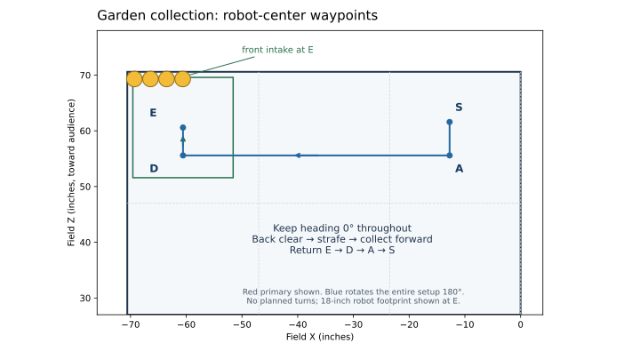

# Hive calibration and practice

For the v8 motion investigation and exact retest order, see [Hive auto diagnostics](POLLEN_HIVE_DIAGNOSTICS.md).

Intermittent tags? Start with the [automatic pipeline benchmark](POLLEN_HIVE_BENCHMARK.md).
It records raw detections before calibration passes; the current confirmation rule is unchanged.

Build **pollen-hive-v41**. The two tested Hive shooters are in Match. Hero, Fast and Out of the Way are in Beta Test.

**v39 (match 2):** there is no Execution row any more. Every hive mode, calibration included, runs
LIVE. Where this guide says DRY or DRIVE, that option is gone from the INIT menu (the controller
still supports it in code). The INIT menus list the rows to check or change first, never-changed
rows last (`PollenHiveRoute.menuOrder`).

**v40:** Secondary Shooter + Flower's return volley no longer waits for the camera. Its cell needs
about 8 balls to tip, so after our 4 preloads it is still UP; the robot feeds as soon as it is back,
settled for 0.3 s, with the launcher (spun up during the return) at 96 % of target. In the
2026-11-19 traces the UP re-confirmation took 1.23 and 1.27 s. The primary's return volley still
waits for UP.

**v41:** new **Beta Secondary Shooter - Angled** (Secondary + Flower from an angled spot: off the wall
8 in, right 10.5 in; profile `secondary-angled`). Both angled modes aim by odometry from where the
cell's middle really is relative to their start (`PollenFieldGeometry.cellLeftOfStartInches`: primary
centered in its wall tile, 0.99 in right of the hive center; secondary start 2.71 in left of it, looking at the hive). The
camera only gates volleys (primary's second; secondary's first).
Print [the two-page practice sheet](drive-team/print/4-hive-practice.pdf). This guide explains the
controls and checks in full; the patch kit README covers applying, building, installing and pushing.

## Choose the smallest useful test

| Driver Hub entry | INIT default | Motor permissions and end condition |
| --- | --- | --- |
| Calibration Hive Camera (No Motors) | No execution row | In the **TeleOp list** (no 30-second timer). Never maps motors or odometry. Continuous camera readiness until STOP. |
| Calibration Primary Shot Only | DRY | No drive. LIVE enables launcher and feed. Starts without a Hive UP check within the primary window, then finishes the volley and stops. |
| Calibration Secondary Shot Only | DRY | No drive. LIVE enables launcher and feed. Waits for UP, one volley, then DONE; 27 s limit. |
| Calibration Garden + Return | DRIVE | No launcher or agitator in any setting. LIVE adds collection intake. Returns to original S and stops; no shot/park. |
| Primary Shooter + Garden | LIVE | Shoot, collect on one forward garden pass, return to S, shoot again if UP, then park. 30 s cutoff. |
| Secondary Shooter + Flower | LIVE | Wait for UP, shoot, drain the nearby flower with two swings and one cleanup cycle, return to S, shoot again if UP, then park. 30 s cutoff. |
| Beta Primary Shooter - Hero | LIVE | Runs the primary garden route with its own saved tuning profile. |
| Beta Primary Shooter - Angled Left | LIVE | Primary garden plan with its own saved profile `primary-angled`: one straight leg from the start to a spot **Angled shot spot away from wall in** (8) and **left in** (8, toward the garden), flywheel spinning up on the way, then a turn in place to `PollenFieldGeometry.aimDegrees` (atan of left minus **Aim target in left of center** over 45.9 in minus away, to our cell's opening; the target defaults to -2 in, 2 in right of the middle, so about -14.8 deg at 8/8), both volleys there, a straight leg to the garden entry, the return to the same spot, and a park that skips PARK CLEAR. INIT checks the turned footprint against the wall. The launcher speed is unchanged although the shot is about 7 in shorter (38.7 in). Not field-tested. |
| Beta Primary Shooter - Fast | LIVE | Primary garden plan with its own saved profile and faster defaults: garden entry 20.32 cm forward / 116 cm left (8 in off the end wall, about 3 in short of the side wall), 2.5 s feeds, and one nudge back onto the shot spot if the return stops 0.5-3 in off it (gives up after 1.5 s and parks as before). Why: [cycle-time research](research/cycle-time.md). |
| Beta Secondary Shooter - Out of the Way | LIVE | Wait for UP, shoot, move to the scoring-end/side-wall corner, and leave for the outer parking slot when the estimated park drive plus margin remains. Shares the secondary's saved settings. |

**Match and Beta Test INIT:** First row, left = RED or right = BLUE. Check the target IDs before START.

The three isolated motor tests use the same controller/settings as the full autos. They still need
Pinpoint READY and correct motor names. **Execution resets to the default above every INIT and is
never saved.** DRY uses virtual launcher readiness and commands zero real motor output. DRIVE
commands only the drivetrain. LIVE enables the mechanisms allowed by the selected test.
Camera-only testing needs just the configured Limelight and the Hub; it does not need Pinpoint.

Place the robot at the shooting mark before pressing INIT and keep it stationary while Pinpoint
zeros its position and heading. Wait for READY. If you move the robot to a new starting spot,
press STOP and INIT again to use that spot as the origin.

## Before the hive is available

1. Apply/build/install the patch. Verify `BUILD pollen-hive-v34` on the Driver Hub.
2. Mount the Limelight 3A rigidly on the back, looking toward the hive, with negligible camera
   roll. Measure tiles to **lens center**; 11.75 inches is the default, not a substitute for measuring.
3. Connect USB-C on the Limelight to the Hub's blue USB-A 3.0 port. Configure it as `limelight`.
4. Default pipeline 4: AprilTag **36h11**, tag size **82.55 mm / 3.25 in**, full 3-D results. Record exposure,
   resolution and downscale. Use the camera INIT row if you use another pipeline index.
5. On the Mac, use the printed tags to check IDs, camera connection and interruption/recovery.
   A print at arbitrary height is not a real-hive calibration. A Mac alone cannot run an FTC OpMode;
   computer tests exercise Java logic, while the camera web page exercises live image detection.
6. Once the Hub is available, use Calibration Hive Camera (No Motors) to enter measured lens height in INIT and
   confirm IDs after START. Do not calibrate to a print at the wrong physical height.

## Camera INIT: measure once, edit without switching modes

D-pad up/down selects one of eight rows; left/right changes it. Triangle restores **one selected
row**. Square saves the camera rows on the Hub. Camera reset is deliberately separate from route
reset. START uses the displayed settings even if not yet saved.

| Camera row | Default | What to do |
| --- | --- | --- |
| Lens height | 11.75 in (robot, 2026-11-17) | Measure floor to lens center. |
| UP tag height | 50.7 in | The center used by the classifier. Replay of v28 and v29 return frames favored 50.7 in. Verify on a visibly UP cell from the shooting spot. |
| DOWN tag height | 35.6 in | Measure on the physically DOWN cell when practical. |
| Tilt up | 31.6 deg (robot, 2026-11-17) | Refit after START with Square if the mount moves, then validate and save with Cross. |
| Sideways correction | 2.62 in (robot, 2026-11-17) | Fitted with tilt if at least 10 accepted frames see all four tags. |
| Pipeline / band / max sideways | 4 / +/-3 in / 12.5 in | Keep unless field evidence supports changing them. |

Enter measurements rather than rounding them to the nominal field values. The tilt fit absorbs a
lens-height error where it was fitted: with the lens entered 1 in wrong, heights read correctly at
the fitting distance and about 0.5 in off at 1.5 times that distance (error = lens error x
(1 - distance / fitting distance)). The DOWN check at the same spot cannot see a lens-height error;
the check at the other start can. A DOWN height mismatch points at the UP/DOWN tag-height entries
(a 1 in UP-entry error shows as 1 in on DOWN) or at the tag size setting (a 10% pose-scale error
shows as about 1.4 in), not at the lens. Fix the measurements in this menu and repeat calibration. **There is no automatic DOWN-height
rewrite**: changing it to fit a bad camera estimate can conceal a calibration problem.

## First calibration: one mode, three short captures

Place the robot at the **primary start**, front against the end wall, rear camera/launcher toward
the hive. Make the near cell physically UP. Confirm the printed tag IDs belong to that cell:
red primary **34-37**, blue primary **42-45**. For the sideways fit, see all four tags and center the
robot on the cell. Do not use the secondary offset start to fit the sideways correction.

1. START **Calibration Hive Camera (No Motors)**. Confirm the *Our cell* and *Tags* lines against the real
   hive. The camera test can identify any cell; the operator must verify this is the near cell.
2. With the cell **UP and still**, press **Square** once. Hold still for three seconds.
   `CANDIDATE` means the displayed tilt/sideways numbers are in use but not saved. At least 20
   distinct solved frames spanning one second are required; rejected solves never count. Per-tag
   spread is checked so inconsistent tags cannot cancel into a convincing average.
3. Keep it **physically UP**. The label defaults to UP; press **Circle**, hold still three seconds.
   Expect `PASS: physical label and production detector agree`.
4. Tip that same cell **DOWN**, let it settle, press **D-pad right** to label it DOWN, then **Circle**.
   Expect PASS if its tags are visible. If all its tags disappear, fresh empty camera frames can
   report **BLOCKED ONLY**: no permission observed, not a positive DOWN detection or height check.
   A disconnected/frozen camera cannot satisfy this check. Visible inconsistent heights are a
   rejection, not a hidden-DOWN pass.
5. Press **Cross**. It saves only after both labeled checks succeed on the current profile and
   cell. It saves exactly the rounded values you previewed. STOP / INIT / START to verify reload.

Square always starts a new candidate version and clears both old checks. A rejected new fit
returns the display to the settings used at START; an older candidate is not left saveable.
Repeating a check revokes that state's previous pass if the repeat fails. Triangle forgets the
cell and both check results; use it after moving to another start. Save a good candidate **before**
moving. At another start, validate the saved mount; do not automatically refit it.

| After START | Action |
| --- | --- |
| Square | New three-second tilt fit; cell must physically be UP at primary start. |
| D-pad left / right | Label the next check physically UP / DOWN. |
| Circle | Three-second check against that label, using the production detector. |
| Cross | Save current profile after both labeled checks. |
| Triangle | Forget cell/checks after moving to another start; retains current mount. |

The screen updates four times a second while the detector runs every loop. This persistent mode
shows **IsHiveReadyForShot**, the camera gate only. It does not claim the launcher is at speed or
the robot is settled. The actual shot tests check those additional conditions.

## Field validation, without repeated installs

At each intended shooting start: identify the correct cell while UP, do labeled UP and DOWN
checks, then leave the mode running for the following tests. Secondary IDs: red **30-33**, blue
**38-41**. Use Triangle after changing starts; keep the robot square and correctly placed.

- Tip the hive 20 times. **Zero false UPs** while physically DOWN or tipping. Allow the detector's
  confirmation delay before expecting UP. A frame that shows our tags between the bands removes
  permission on that frame; frames that show no tags at all keep it for up to 0.20 s after the
  last sighting. Write down any tip where the tags vanished without a between-bands reading.
- Cover our tags while the other hive stays visible. Read UNKNOWN / false, never permission from
  the other hive. Unplug/replug the camera and verify recovery needs fresh confirmations.
- Move the robot roughly one inch and a few degrees around the shooting position. Verify UP still
  works. Restore the exact starting placement before motion tests.
- Rock slowly through a tip. Verify UNKNOWN in the transition. Recheck with launcher vibration
  during the stationary shot test; static-camera success alone does not establish live reliability.
  The shot modes log a `HIVE` line for every new camera frame while shooting (tags seen, height,
  state, feed, launcher speed). Pull logcat after a LIVE shot test: a drop in `tags=` right after
  `feed=true` means our own balls or vibration hide the tags.

A height transform remains valid across position/yaw changes **only with a level chassis, rigid
mount, negligible unmodeled roll, and correct tag pose scale**. Recalibrate after moving the mount,
changing lens height, or changing pipeline geometry/resolution/downscale. Confirm at each event.

## Fast motor-testing loop

1. **Primary shot ONLY, DRY:** at the proper S pose, confirm the simulated preload starts with
   the hive DOWN or out of view. DRY uses virtual flywheel speed and keeps all motors off.
2. **Primary shot ONLY, LIVE:** small batch, clear shot area, someone on STOP. No drive output.
   Starting feed needs settled odometry and measured launcher speed at or above 96% of target.
   Repeat at the secondary start in secondary shot ONLY, which also requires more than 1 s of confirmed UP.
3. **Garden + return, DRIVE, no balls:** start at normal primary S. It skips shooting, drives the
   existing CAD route, returns and settles at S, then DONE. No park and no coordinate re-zero midrun.
4. **Garden + return, LIVE:** collection intake runs on pickup/hold, launcher and agitator stay off.
   Check actual pickup, retention with a stopped flywheel, clearances and return error.
5. **Full primary / secondary, LIVE:** integrate after the isolated tests work. First run with
   small batches. Record when PARK starts and whether the robot arrives before the 30 s cutoff.
   The trace records the last phase and pose if the timer interrupts travel.

Motor tests use the regular INIT menu: D-pad row/value, LB/RB jump five, Triangle resets one row,
Square saves. **Circle resets route values only, keeping camera settings and selected Execution.**
Resetting the Execution row itself uses the selected OpMode's default. All three practice modes
share their corresponding primary/secondary saved settings with full autos; a saved route/feed
edit applies to both. Review the CHANGED and UNSAVED lines every INIT.

## Session reports and promoting results

Camera capture outcomes and saves are recorded automatically in
`/sdcard/FIRST/pollen-hive/reports/camera-*.txt`. Each motor run writes its run type, settings,
phase/state/feed changes, elapsed time and measured pose; the return/finish event includes the
return error relative to S. Reports are best-effort; a write failure is shown and never authorizes
feeding. Detailed live `PollenHive` lines remain in the Robot Controller log. Reports do not
infer actual pickup count or automatically score an unlabeled 20-tip test: record those manually.
Pull the settings and reports once after the session:

```bash
adb connect 192.168.43.1:5555
session_dir="$HOME/Desktop/pollen-hive-$(date +%Y%m%d-%H%M%S)"
adb pull /sdcard/FIRST/pollen-hive "$session_dir"
python3 tools/hive-promote-defaults.py "$session_dir"            # preview
# Only after the numbers are proven on the field:
python3 tools/hive-promote-defaults.py "$session_dir" --write
bash tools/test-pollen-sequence.sh
ftcgradle :TeamCode:testDebugUnitTest :TeamCode:assembleDebug
git diff
# Commit the intended defaults, then install/push through the usual workflow.
```

Pull the Robot Controller log too (see [operating manual](POLLEN_AUTONOMOUS.md#robot-log)).
Record build/commit, physical cell IDs, lens/UP/DOWN measurements, pipeline settings, false-UP count,
pickup count, return error, and cycle time. Settings files contain overrides, not full snapshots;
keep the commit with the reports. Execution is never promoted; review any forced RED/BLUE side.

## How height and readiness work

Limelight camera coordinates are x right, y down, z out of the lens, in metres. Convert the tag's
vertical displacement to inches after rotating by measured camera pitch:

`tag height = lens height + (z*sin(tilt) - y*cos(tilt)) / 0.0254`

The camera is mounted on the rear; that changes viewing direction, not this vertical transform.
The state classifier requires the accepted visible tags of our locked cell to agree. A state
needs at least four distinct frames showing our tags over 0.15 s, and expires 0.20 s after the
last new frame or the last frame that showed our tags. A contradicting observation (between bands,
tags that disagree, the other state) revokes UP immediately and restarts confirmation. A new frame
without our tags (ball in flight, blur, glare) is not a contradiction: it neither counts nor
resets, until 0.20 s have passed since the last sighting. Uncalibrated, invalid, missing or inconsistent
observations produce UNKNOWN. Only UP grants camera readiness. Camera input rejects wrong pipeline,
invalid poses, duplicate IDs, stale SDK results and excessive total image latency.

The Match and Beta Test Hive autos open on Alliance, then Execution, then Start delay. Press D-pad left
for RED or right for BLUE every INIT. Check the displayed tag range. START without a selection
blocks the run. Press STOP and INIT to retry. Triangle on Alliance clears the choice. Circle keeps
the current alliance and execution. Square saves tuning; the match choice never overwrites a calibration profile.
Alliance and shooter role select the eligible cluster. Its measured tag heights determine UP and DOWN.

In calibration, Side AUTO locks the nearest eligible cell after four consecutive fresh observations. Primary
allows cells 34/42, secondary 30/38; RED or BLUE forces the appropriate one. Losing observations
before identification now restarts its count. An established lock survives the garden trip.
Secondary INIT uses the production detector. Primary shooter INIT shows the configured target
without checking its state. Use the camera-only mode to check UP or DOWN before a run.

## Calibration Garden + Return route, derived from the saved repo layout

The source of field measurements is [POLLEN_FIELD_LAYOUT.md](POLLEN_FIELD_LAYOUT.md), especially Zones and Game pieces. Nominal red primary start is `(X,Z)=(-12.74164098,61.585)` inches. Garden ball centers are approximately `(-69.31,69.3), (-66.42,69.3), (-63.53,69.3), (-60.64,69.3)`. Blue uses the 180-degree rotated setup, with identical relative route settings.



Route forward = toward hive from START; route left = left while looking at hive. **All distances are centimeters, absolute robot-center coordinates from START.** Heading 0 is the starting chassis orientation (front toward wall, rear toward hive). The v9 garden route keeps heading 0 throughout: back clear, strafe sideways, drive forward to collect, then retrace the corridor.

| Point/action | Field X,Z (in, red) | Route forward,left (cm) | Heading |
| --- | --- | --- | --- |
| S: shooting start | -12.742, 61.585 | 0, 0 | 0 |
| A: clear end wall | -12.742, 55.585 | 15.24, 0 | 0 |
| D: intake alignment | -60.585, 55.585 | 15.24, 121.522 | 0 |
| E: collect toward wall | -60.585, 60.585 | 2.54, 121.522 | 0 |
| Return | E → D → A → S | same points in reverse corridor | 0 |

The chassis keeps its starting orientation throughout. A→D is one sideways move; no turning waypoints are used. D/E leave the body's left edge 1 inch from the side wall; E leaves its front edge 1 inch from the end wall. The intake runs only for D→E and the collection hold; launcher and agitator stay commanded off throughout the garden. The robot backs out before crossing back to the shooting position. It does not reset odometry during the cycle.

**Intake reach is the remaining mechanical assumption.** At E, the leftmost ball center is 8.725 inches left of the robot centerline. A centered mouth would need about **17.45 inches of usable width** to cover all four centers at once, plus appropriate reach into the ball row. A narrower intake can collect fewer balls on this route. The code cannot confirm ball count. Measure the actual intake envelope/reach and test with balls before claiming a four-ball pickup. The footprint checker assumes the entire robot, including intake, fits within 18×18 inches.

The geometry check (run by the computer tests and at INIT) samples translations at most 0.1 in apart and turns at one-degree steps against the repo's fixed obstacle envelopes, walls and alliance midline. It doesn't account for partners, scattered pieces, build tolerances or odometry error. Start with DRIVE and stop if the path differs from the drawing.

## Route and timing defaults (`PollenHiveSettings.ROUTE`)

Change any of them in INIT (the geometry check blocks START and Square if a change would hit a wall
or the midline), or promote saved changes into the code. The robot log's START line lists every value.

| Setting | Default |
| --- | --- |
| Start delay | 0 s; secondary waits for an actual UP, not a guessed partner delay |
| Match first / second agitator feed | 3 / 3 s from feed start in the two Match modes and Hero. Calibrations and Make Room use their existing feed rows. |
| First-shot window | 5 s in Calibration Primary Shot Only. The Match primary and Hero waits for a ready launcher and settled pose. |
| Launcher | 1180 ticks/s; PIDF unchanged |
| Travel / turn / pickup drive power | 0.60 / 0.40 / 0.20 |
| Match travel and park power | 1.00 for the two Match modes and Hero, which ramp and brake at the route targets |
| Measured park drive from the shooting spot | 5.46 s primary and Hero, 3.47 s secondary. |
| Collection intake / hold | 0.50 power / 0.50 s |
| Shooting intake / agitator | 1.00 / 1.00 in the Match autos and Hero. The calibration and Make Room shooting intake defaults to 0.50. |
| Pause feed below launcher % | 0 (off), all hive modes. During a volley the agitator holds while the launcher is below this % of its target and restarts at 96 %, so each ball leaves near full speed. The volley clock keeps running. For accuracy A/B tests in Calibration Primary Shot Only (try 92). |
| Clear-out s after volley | 3 s, Match autos and Hero only. After a volley finishes, the agitator and launcher keep running together this long while the robot drives on (or waits to park), so leftover balls leave before collecting. One time for both, so the agitator never feeds a stopped launcher. Not a feed: no pose, speed or UP check, intake and wheels untouched. The park deadline cancels it. 0 turns it off. Range 0-6 s. |
| Clearance forward / first turn left / garden turn left | 15.24 / 43.836 / 108.822 cm |
| Pickup left / forward | 121.522 / 2.54 cm |
| Transit / pickup heading | fixed 0 / 0 degrees; final shooting heading always returns to zero |
| Execution / Side | LIVE / choose RED or BLUE each Match and Beta Test INIT |
| Park | on; three CAD-derived waypoints (existing departure corridor and parking spot) |
| Make room corner forward / left | 2.54 / -128.41 cm: 1 in off the scoring-end and side walls (CAD); reached via Park1 forward to clear the flower |
| Park margin s | 1.0 s by default. D-pad left/right changes it by 0.5 s. The controller reserves estimated travel plus this margin and can interrupt shooting or collection for parking. |

The Calibration Garden + Return route is about **6.48 s** by the existing drive estimate. The Match modes and Hero use the wall-contact collection routines, separate entry waypoints, and their own collection settings in INIT. [Collection practice](POLLEN_COLLECTION_PRACTICE.md)

## Timing and autonomous behavior

- Primary preloads skip the Hive UP check. The primary return shot and the secondary's first volley require more than 1 s of continuous confirmed UP to latch permission. Before the latch, losing UP restarts the timer. After the latch, the camera continues reporting through the volley.
- The launcher must reach measured speed before feed starts. Once started, feeding continues through camera changes and speed dips for the configured duration.
- In the latest field traces, the last clear velocity dip came 2.11 s into the primary preload and 1.68 s into the return volley. The 3 s settings shorten the feed window while leaving margin for those events. Count all balls on the next field run because velocity alone cannot confirm the last ball cleared.
- Since v33, after each volley in the Match autos and Hero, the **clear-out** keeps the agitator and launcher running 3 s together while the robot leaves (**Clear-out s after volley**). It adds no time: it overlaps the outbound drive, or the wait before parking after the return volley. Balls it fires while the robot moves may not score; the point is an empty robot before collecting. Both stop on the same tick, so no ball is pushed into a stopped launcher. The park deadline cancels the clear-out. Before v33 the launcher and agitator were commanded off on the departure tick.
- Collection does not wait for flywheel spin-down. The Match autos and Hero keep the launcher off during collection (after the clear-out) and bring it up to speed as soon as they start the return. The intake and agitator stay off during return transit and alignment.
- After return, position must be within 0.5 inch of START, heading within 2 degrees, and speed/turn rate settled for 0.3 seconds. At the shooting position, the Match autos and Hero turn toward 0 degrees if the heading error exceeds 2 degrees. Old readiness is discarded while traveling and during the correction. Fresh observations reconfirm UP. Our cell stays locked.
- The primary collection autos wait for a fresh UP latch after settling back at the shooting pose; Secondary Shooter + Flower does not (v40). The park deadline interrupts the active phase and zeroes shooting outputs. From the shooting position, the default deadlines are **23.54 s primary** and **25.53 s secondary**. When farther away, departure also budgets the clearance and return route before parking. The **30-second** cutoff stops whatever phase is active.
- An unavailable or uncalibrated camera prevents only the hive-gated volleys.
- A 0.25-second control-loop gap, invalid odometry, lost Pinpoint READY status, stuck drive/turn or route failure latches a stop. There is no guarantee of finishing parking if the robot runs slower than the estimates; the deadline still wins.

## Code and verification

`IsHiveReadyForShot` is the state detector; `PollenHiveCalibration` captures/validates;
`PollenHiveCalibrationSession` manages the current candidate and check results. `PollenHiveCheck`
is the motor-free UI. `PollenHiveAuto` has MATCH, SHOT_ONLY and GARDEN_RETURN run types; hardware
limits are also enforced in `PollenHiveOpMode`. Settings and routes remain in `PollenHiveSettings`
and `PollenHiveRoute`. `PollenHiveStore` writes overrides and compact reports.

Computer regressions cover the wrong-state fit, impossible solves, per-tag disagreement, duplicate
frames/minimum span, hidden versus disconnected DOWN, candidate resets, cell identification,
settings and primary/secondary/practice simulations. The camera decoder has 13 real-JSON checks.
The v32 desktop verification included Android unit tests and debug APK assembly. The park-margin tests exercise the predicted timing on the computer. Field timing still depends on actual travel speed and wall contact.
