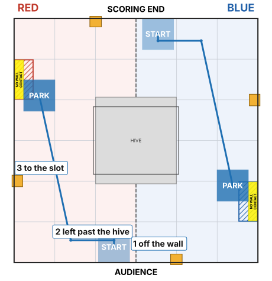
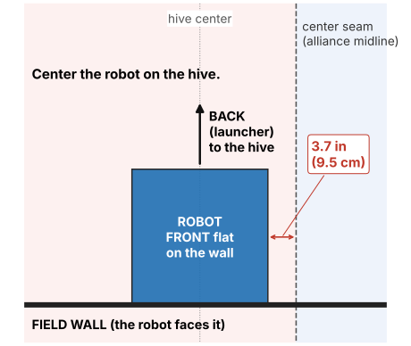
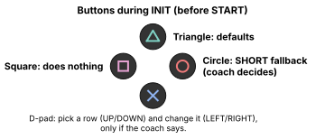

# Odo ROBOT Shoot + Park

**Use this when we shoot first.** It is our main autonomous.

The robot shoots its 4 pollen, then drives to the parking slot on its own.
It measures where it is as it drives (odometry), so it ends up in the same place every time.

## What the robot does

| Time | What happens |
| --- | --- |
| 0 - 0.5 s | Drives gently **forward** into the wall in front of it, to line itself up straight. This is normal. |
| from 0.5 s | Launcher spins up: 3 s at most. |
| next 10 s | Shoots the pollen. |
| by about 19 s | Drives **backward** (launcher end first): (1) a little off the wall, (2) left past the hive, (3) to the **INNER** parking slot. Then it stops. |

Points if it works: **LEAVE 3 + PARK 5**. Our partner parks in the **OUTER** slot.

If something blocks it on the way, it **stops where it is**. It never skips ahead to the next
leg from the wrong spot, because that straight line could go through the hive.

## Before the match

**1. Agree with the partner.** We shoot first. They shoot second (or don't shoot), stay out
of our lane, and park in the OUTER slot. Show them the pit sheet.

**2. Put the robot on the field.**

- **Red:** at the **audience** wall. **Blue:** at the **scoring-end** wall.
- **Front** of the robot **flat against the wall**. The **back (the launcher) faces the hive**.
- **Center the robot on the hive.** Its edge is 3.7 in (9.5 cm) from the center seam.
- Exactly **4 pollen** loaded. Not touching a flower. Not in the loading zone.

**3. On the Driver Hub**, pick **Odo ROBOT Shoot + Park**. It's in the autonomous list, group *Pollen Odometry*.

**4. Press INIT.** Don't touch the robot for 1 second: the odometry sensor is getting ready.

**5. Press Triangle once.** That puts every setting back to the defaults. Then make only the
changes the coach asks for (usually none).

**6. Check the screen:**

| Line | Should say |
| --- | --- |
| **ROUTE** (the first line) | `FULL PARK: shoot, then 3 legs to the parking slot` |
| Build | `pollen-hive-v5` |
| Mode | `ODOMETRY Shoot + Park` |
| Odometry x fwd / y left / heading | numbers near 0 (not `NOT VALID`) |
| Status | `READY - no movement until START` |

**7. Press START** when the match starts.

- **Triangle:** back to the defaults. Always safe.
- **Square** and **Circle:** do nothing.
- **D-pad:** changes settings. Only if the coach says.

## If something is wrong

| You see | What it means | Do this |
| --- | --- | --- |
| `BLOCKED: ... No goBILDA Pinpoint named "odometry"` | The odometry sensor isn't found | Use **EMERGENCY Timed Shoot + Park** instead ([emergency timed page](fallback-timed-autos.md)). Tell a programmer. |
| `Odometry ...: NOT VALID` | The odometry sensor isn't reading | Press STOP, then INIT again with the robot still. Still bad: use the emergency timed mode. |
| `READY FOR DEPARTURE ONLY - SHOOTER FAILED` | The launcher didn't start up | The robot will still drive and park, but won't shoot. Tell a programmer; check the launcher cables. |
| `NOT READY - over time budget` | Someone's settings take too long | Press Triangle. |
| ROUTE isn't `FULL PARK` (and the coach didn't ask) | Someone changed a leg | Press Triangle. |
| `PINPOINT FAULT` | A pod cable is loose | Check both pod cables. Still there: [emergency timed mode](fallback-timed-autos.md). |
| Any other `BLOCKED` | Something isn't plugged in, or the wrong robot configuration is active | Tell a programmer. |

## After the match, tell the programmers

- **The match number** (the robot keeps a log; a programmer pulls it after the event).
- Did it shoot all 4? Did it park in the slot? Was it touching the side wall?
- **Photograph the screen before you INIT TeleOp**: it shows the last **Phase** and any **Warning**.
