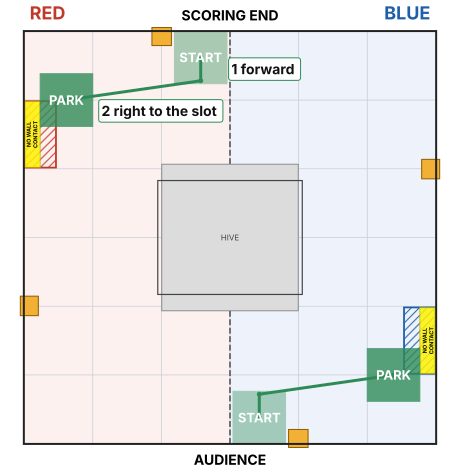
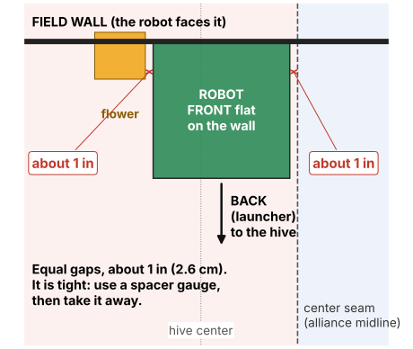
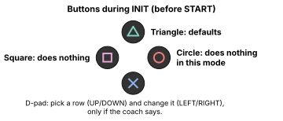

# Odo Supporting Shooter Auto

**Use this when our partner shoots first.** We wait for them to tip the hive, then we shoot.

The robot waits 12 seconds, shoots, then drives to the parking slot on its own.
It measures where it is as it drives (odometry).

## What the robot does

| Time | What happens |
| --- | --- |
| 0 - 12 s | Waits. Just before 12 s it drives gently **forward** into the wall to line itself up. This is normal. |
| 12 - 15 s | Launcher spins up. |
| 15 - 22.5 s | Shoots the pollen. |
| about 22.5 - 26 s | Drives **backward** (launcher end first): (1) away from the wall, clear of the flower, (2) right to the **OUTER** parking slot. Then it stops. |

Points if it works: **LEAVE 3 + PARK 5**. Our partner parks in the **INNER** slot.

**Time is tight.** The robot can't move until it has finished shooting at 22.5 s, and our program
stops everything at 27 s to be safe. Don't add delay or feed time unless the coach says.

## Before the match

**1. Agree with the partner.** They shoot first, finish by about **14 s**, then drive away to the
INNER slot. We start shooting at **15 s**. Show them the pit sheet.

**2. Put the robot on the field.**

- **Red:** at the **scoring-end** wall. **Blue:** at the **audience** wall.
- **Front** of the robot **flat against the wall**. The **back (the launcher) faces the hive**.
- **Between the flower and the center seam, with the same gap on both sides: about 1 in (2.6 cm).**
  It's tight. Use a spacer gauge to set the gaps, then take it away before the match.
- Exactly **4 pollen** loaded. **Not touching the flower.** Not in the loading zone.

**3. On the Driver Hub**, pick **Odo Supporting Shooter Auto**. It's in the autonomous list, group *Pollen Odometry*.

**4. Press INIT.** Don't touch the robot for 1 second: the odometry sensor is getting ready.

**5. Press Triangle once.** That puts every setting back to the defaults, including the 12 s wait.
Then make only the changes the coach asks for. A different wait is a *Start delay seconds* change, if the partner needs it.

**6. Check the screen:**

| Line | Should say |
| --- | --- |
| **ROUTE** (the first line) | `SUPPORT PARK: wait, shoot, then park in the outer slot` |
| Build | `pollen-odo-v11` |
| Mode | `ODOMETRY Supporting Shooter` |
| Odometry x fwd / y left / heading | numbers near 0 (not `NOT VALID`) |
| Start delay seconds | `12.00` |
| Status | `READY - no movement until START` |

**7. Press START** when the match starts. The robot will sit still for 12 seconds. That's correct.

- **Triangle:** back to the defaults. Always safe.
- **Square** and **Circle:** do nothing in this mode.
- **D-pad:** changes settings. Only if the coach says.

## If something is wrong

| You see | What it means | Do this |
| --- | --- | --- |
| `BLOCKED: ... No goBILDA Pinpoint named "odometry"` | The odometry sensor isn't found | Use **EMERGENCY Timed Supporting Shooter** instead ([emergency timed page](fallback-timed-autos.md)). Tell a programmer. |
| `Odometry ...: NOT VALID` | The odometry sensor isn't reading | Press STOP, then INIT again with the robot still. Still bad: use the emergency timed mode. |
| `READY FOR DEPARTURE ONLY - SHOOTER FAILED` | The launcher didn't start up | The robot still waits out the shooting time, then parks. Tell a programmer. |
| `NOT READY - over time budget` | Someone's settings take too long | Press Triangle. |
| `PINPOINT FAULT` | A pod cable is loose | Check both pod cables. Still there: [emergency timed mode](fallback-timed-autos.md). |
| Any other `BLOCKED` | Something isn't plugged in, or the wrong robot configuration is active | Tell a programmer. |

## After the match, tell the programmers

- Did the partner tip the hive before 15 s? Did we shoot all 4? Did we park in the slot?
- Did the robot touch the flower when it drove forward?
- **The match number** (the robot keeps a log). If it stopped before parking: **photograph the screen before you INIT TeleOp**.
