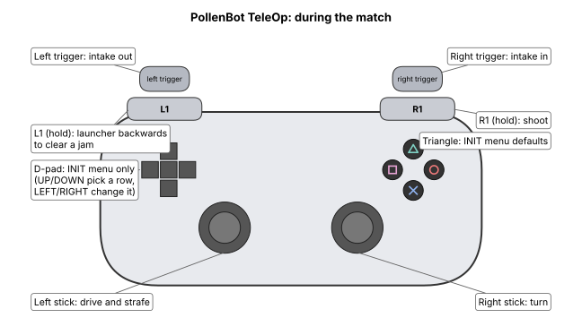

# PollenBot TeleOp

The driver-controlled part of the match. On the Driver Hub pick **PollenBot** (TeleOp list).
After autonomous it is already selected for you: just press INIT, then START.

## Driving and shooting

| Control | What it does |
| --- | --- |
| **Left stick** | Drive forward/back and slide (strafe) left/right |
| **Right stick** | Turn |
| **Right trigger** | Intake in (squeeze harder = faster) |
| **Left trigger** | Intake out (spits pollen back out) |
| **R1, hold** | Shoot. The launcher spins up, then feeds by itself and keeps feeding until you let go. |
| **L1, hold** | **Unjam:** runs the launcher slowly backwards to push a stuck ball out. While you hold L1 nothing feeds, even if R1 is held too. |

**Shooting:** hold R1 the whole time you want to shoot. Feeding starts as soon as the launcher
is up to speed, or after 3 seconds at most. Let go of R1 to stop.

**Jammed?** Let go of R1. Hold L1 for a second or two. You can also squeeze the left trigger to push
balls out of the intake. Let go of L1, then hold R1 to shoot again.

## The INIT menu (before START)

You can change four settings before START. Usually leave them alone.

| Row | Default | What it changes |
| --- | --- | --- |
| Launcher ticks/s | 1180 | How fast the launcher spins (changes by 20) |
| Spin-up before feed | 3.0 s | Longest wait before feeding starts |
| Agitator power while feeding | 1.00 | How hard the agitator pushes balls in |
| Drive power | 100% | Lower it for slower, more careful driving |

- **D-pad UP/DOWN:** pick a row (marked `>`). **D-pad LEFT/RIGHT:** change it. Tap and let go.
- **Triangle:** all back to the defaults. The screen says `Settings: DEFAULTS` or `CHANGED - check before START`.
- Settings stay until the robot app restarts, so **check the INIT screen before every match**.
- The screen should show **Build `pollen-hive-v4`**.

## What the screen tells you during the match

| Feed line says | Meaning |
| --- | --- |
| `off (hold R1; L1 = reverse to clear a jam)` | Not shooting |
| `spinning up` | R1 held, launcher getting up to speed |
| `FEEDING (started at 1.2 s: up to speed)` | Shooting |
| `FEEDING (... spin-up timer)` every time | Launcher never gets fully up to speed. Tell a programmer: check the battery and launcher cable. |
| `REVERSING launcher (L1) - no feed` | Unjamming |

`(measured ~0: check launcher encoder cable)` next to the launcher speed means the launcher's
encoder cable is loose. Shots will be weak or uneven: tell a programmer after the match.
