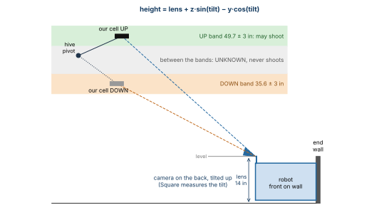

# Hive match setup and practice

**Build pollen-hive-v32 - experimental.** Print front/back. Full steps: `docs/POLLEN_HIVE_TESTING.md`.
Keep existing match autos available. Rear camera/launcher face hive; **front intake faces end wall**.

For intermittent tags, run **Calibration Hive Pipeline Benchmark** first (separate benchmark card).

## Camera setup and calibration (NO MOTORS)

Limelight named **limelight**; USB to Hub blue port. Saved AprilTag pipeline (code default 4): 36h11, **82.55 mm**, full 3-D.
Use **Calibration Hive Camera (No Motors)**, in the **TeleOp list**. It maps no motors or odometry and runs until STOP.

| Step | Do this |
| --- | --- |
| 1. Measure in INIT | Floor to lens center (default **11.75 in**); floor to UP/DOWN tag-row centers (**49.7 / 35.6 in** nominal). D-pad selects/edits camera rows. Triangle resets one row; Square saves. |
| 2. Fit tilt | PRIMARY start, square to wall, centered. Near cell **physically UP**. START. Check correct IDs; see all four for sideways fit. Square, hands off for **3 s**. Display uses CANDIDATE. |
| 3. Check UP | Still UP: D-pad **left**, then Circle. Hold still 3 s. Expect **PASS**. |
| 4. Check DOWN | Tip same cell DOWN, let it settle. D-pad **right**, Circle. Expect PASS, or **BLOCKED ONLY** if tags hidden. Hidden is not a DOWN height measurement. |
| 5. Save/reload | Cross saves after both checks. STOP / INIT / START verifies reload. Save before moving. Triangle forgets the cell/checks after changing starts. |

**Cell IDs:** primary red 34-37, blue 42-45; secondary red 30-33, blue 38-41. Confirm on the real hive.
Square starts a fresh candidate and clears checks. A rejected fit cannot save an old candidate.
Wrong label / noisy readings / inconsistent tags = reject. Correct measurements in INIT and repeat;
**no automatic DOWN-height adjustment**. Cross saves exactly the previewed numbers.

## Validate at each shooting start

- With the near cell UP, identify it, then check UP and DOWN. At secondary starts, validate the
  same mount; do not refit sideways from the offset position.
- Leave the display running: tip **20 times**, cover our tags while the other hive is visible,
  unplug/replug, rock through the middle. **Zero false UPs**. UNKNOWN means no shot permission.
- Test small placement errors, then restore S. A rigid mount, level chassis and negligible camera
  roll are assumed. Recalibrate if mount/height/pipeline geometry changes.

**Record:** lens _____ in; UP / DOWN tags _____ / _____ in; tilt _____ deg; cell IDs _____;
false UP _____ / 20. Capture reports save automatically. The screen tests the **camera gate only**.

## Practice one behavior at a time

| Driver Hub mode | Default / what happens |
| --- | --- |
| Calibration Primary Shot Only | **DRY**. No drive. LIVE fires within the first-shot window without checking UP. |
| Calibration Secondary Shot Only | **DRY**. No drive. LIVE waits for UP, fires, stops. |
| Calibration Garden + Return | **DRIVE**. No launcher/agitator. LIVE adds collection intake. Returns to S and stops, no park. |
| Primary Shooter + Garden | **LIVE**. Shoot, one garden approach, return to S, shoot if UP, park. 30 s cutoff. |
| Secondary Shooter + Flower | **LIVE**. Wait for UP, shoot, drain with two swings and one cleanup cycle, return to S, shoot if UP, park. 30 s cutoff. |
| Beta Primary Shooter - Hero | **LIVE**. Primary garden plan with separate saved settings for beta testing. |
| Beta Secondary Shooter - Out of the Way | **LIVE**. Wait for UP, shoot, wait in the far corner, park on its deadline. |

Validate the camera, then test shot-only in DRY and LIVE and garden in DRIVE and LIVE before
running full autos. Keep someone on STOP and check Pinpoint READY. Match autos and Hero pre-spin on
return. The **Park margin s** row defaults to **1.0 s** and adjusts in **0.5 s** steps. Park can interrupt feed.
LIVE feeds from a settled pose at measured launcher speed for up to **3 s**. The return shot and
secondary preload also require more than **1 s** of confirmed UP.

## Motor-mode INIT menu

**Match and Beta:** On the first INIT row press **left for RED** or **right for BLUE**. Check the tag IDs before START.

D-pad row/value; LB/RB jump five. **Triangle** resets one row. **Circle** resets route values only,
keeping camera and Execution. **Square** saves. Execution is never saved and resets each INIT to
the mode's default above. The Match autos and Hero show their garden or flower settings just after
Alliance and Execution. Collection and shooting intake default to 1.00.
Check BUILD, run type, Execution, CHANGED values, camera profile, cell/alliance and Pinpoint READY.

The diagram shows **Calibration Garden + Return** from **S**. **Calibration Garden Pickup** starts at
the garden entry and finds the right wall, then the wall behind the balls. Four ball centers need
about **17.45 in** of centered intake width. Measure actual reach.

Before departure, a shift over 2 in or 10° stops the run. Check drive wiring and retry DRY if this trips.
After STOP, download the reports with `bash tools/ftc.sh logs NEW_FOLDER`. Record pickup count,
return error, cycle time, and false UPs. See the full guide for promoting saved settings.
