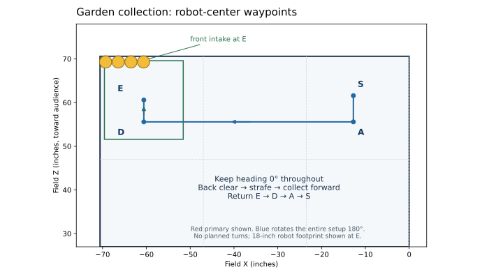

# Hive calibration and practice

**Build pollen-hive-v20 - experimental.** Print front/back. Full steps: `docs/POLLEN_HIVE_TESTING.md`.
Keep existing match autos available. Rear camera/launcher face hive; **front intake faces end wall**.

For intermittent tags, run **Calibration Hive Pipeline Benchmark** first (separate benchmark card).

## Camera setup and calibration (NO MOTORS)

Limelight named **limelight**; USB to Hub blue port. Saved AprilTag pipeline (code default 4): 36h11, **82.55 mm**, full 3-D.
Use **Calibration Hive Camera (No Motors)**, in the **TeleOp list**. It maps no motors or odometry and runs until STOP.

| Step | Do this |
| --- | --- |
| 1. Measure in INIT | Floor to lens center (default **11.75 in**); floor to UP/DOWN tag-row centers (**49.7 / 35.6 in** nominal). D-pad selects/edits camera rows. Triangle resets one row; Square saves. |
| 2. Fit tilt | PRIMARY start, square to wall, centered. Near cell **physically UP**. START. Check correct IDs; see all four for sideways fit. Square, hands off for **3 s**. Display uses CANDIDATE. |
| 3. Check UP | Still UP: D-pad **left**, then Circle. Hold still 3 s. Expect **PASS**. |
| 4. Check DOWN | Tip same cell DOWN, let it settle. D-pad **right**, Circle. Expect PASS, or **BLOCKED ONLY** if tags hidden. Hidden is not a DOWN height measurement. |
| 5. Save/reload | Cross saves after both checks. STOP / INIT / START verifies reload. Save before moving. Triangle forgets the cell/checks after changing starts. |

**Cell IDs:** primary red 34-37, blue 42-45; secondary red 30-33, blue 38-41. Confirm on the real hive.
Square starts a fresh candidate and clears checks. A rejected fit cannot save an old candidate.
Wrong label / noisy readings / inconsistent tags = reject. Correct measurements in INIT and repeat;
**no automatic DOWN-height adjustment**. Cross saves exactly the previewed numbers.

## Validate at each shooting start

- With the near cell UP, identify it, then check UP and DOWN. At secondary starts, validate the
  same mount; do not refit sideways from the offset position.
- Leave the display running: tip **20 times**, cover our tags while the other hive is visible,
  unplug/replug, rock through the middle. **Zero false UPs**. UNKNOWN means no shot permission.
- Test small placement errors, then restore S. A rigid mount, level chassis and negligible camera
  roll are assumed. Recalibrate if mount/height/pipeline geometry changes.

**Record:** lens _____ in; UP / DOWN tags _____ / _____ in; tilt _____ deg; cell IDs _____;
false UP _____ / 20. Capture reports save automatically. The screen tests the **camera gate only**.

## Practice one behavior at a time

| Driver Hub mode | Default / what happens |
| --- | --- |
| Calibration Primary Shot Only | **DRY**. No drive. LIVE must start its volley within the first-shot window. |
| Calibration Secondary Shot Only | **DRY**. No drive. LIVE waits for UP, fires, stops. |
| Calibration Garden + Return | **DRIVE**. No launcher/agitator. LIVE adds collection intake. Returns to S and stops, no park. |
| Beta Test Primary Shooter + Garden | **LIVE**. Shoot, collect, return, wait/shoot if UP, park. |
| Beta Test Secondary Shooter | **LIVE**. Wait for UP, shoot, park. |
| Beta Test Secondary Shooter - Make Room | **LIVE**. Partner is the hero. Wait for UP, shoot, wait in the far corner, park with **2 s** left. |

**Order:** camera validation; shot ONLY DRY then LIVE with a small batch; garden DRIVE without
balls then LIVE pickup; full autos last. Someone stays on STOP. Every motor run requires Pinpoint
READY and ends by **27 s**. DRY uses virtual launcher speed. LIVE starts from a settled pose
at measured launcher speed after more than **1 s** of confirmed UP. The default volley feeds
for **4 s** through camera changes and speed dips. Use camera-only mode for indefinite observation.

## Motor-mode INIT menu

**Beta Test only:** On the first INIT row press **left for RED** or **right for BLUE**. Check the tag IDs before START. Choose again after each INIT.

D-pad row/value; LB/RB jump five. **Triangle** resets one row. **Circle** resets route values only,
keeping camera and Execution. **Square** saves. Execution is never saved and resets each INIT to
the mode's default above. Saved practice settings are shared with the corresponding full auto.
Check BUILD, run type, Execution, CHANGED values, camera profile, cell/alliance and Pinpoint READY.

Start **Calibration Garden + Return** at **S**. For **Calibration Garden Pickup**, start at the garden entry. Keep the starting heading: back clear, strafe sideways, then
drive front-first to collect; back out and retrace to S. No midrun odometry reset. Body clearance is
only **1 in**. Four ball centers need about **17.45 in** of centered intake width; measure actual reach.

Before departure, a shift over 2 in or 10° stops the run. Check drive wiring and retry DRY if this trips.
After STOP, download the reports with `bash tools/ftc.sh logs NEW_FOLDER`. Record pickup count,
return error, cycle time, and false UPs. See the full guide for promoting saved settings.
