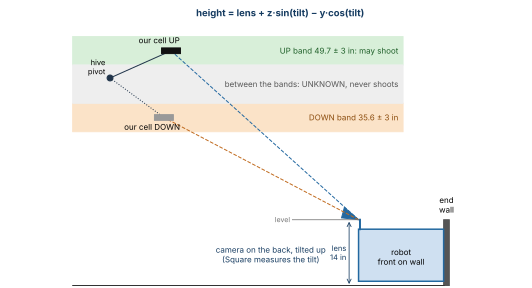
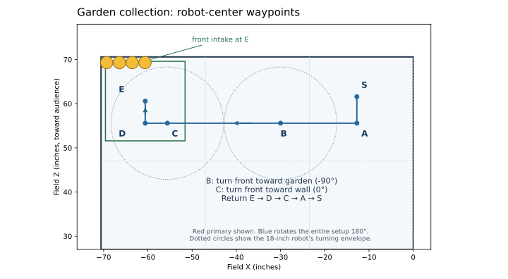

# Hive camera: calibrate, then practice

**Build pollen-hive-v2, experimental.** Full guide: [POLLEN_HIVE_TESTING.md](../POLLEN_HIVE_TESTING.md). Keep the existing match autos available.

**Normal use: place the robot, pick the auto, INIT, START.** The robot finds **its own hive cell** from the tags straight behind it (Side AUTO), works out how **high** they are (UP cell about 49.7 in, DOWN about 35.6 in), and shoots only on a steady UP.

## Calibrate (TEST Hive camera, NO MOTORS)

| Step | Do this | Write down |
| --- | --- | --- |
| 1. Measure | Tape: tiles to **lens center**, and tiles to the middle of the **tag row under the UP cell**. Over 1/4 in from 14.0 / 49.7? Set that camera row in an auto's INIT menu, Square. | lens \_\_\_\_\_ in, tags \_\_\_\_\_ in |
| 2. Tilt | Robot at **red primary start** (front on the wall, centered behind the hive). Our cell (34-37) **UP**. START. *Tags* lists 34 35 36 37. Hands off. **Square**. Wait 3 s. | tilt \_\_\_\_\_ deg, sideways \_\_\_\_\_ in |
| 3. Check | Same spot, UP: **Circle** → PASS. Our cell **DOWN**: **Circle** → PASS (`Only 0 frames` = tags hidden, OK). Red **secondary start**: **Triangle**, cell 30-33 UP, **Circle** → PASS. | UP \_\_\_\_\_ in, DOWN \_\_\_\_\_ in, secondary \_\_\_\_\_ in |
| 4. Save | **Cross**: saved on the Hub; both autos use it from their next INIT (shown as CHANGED). | |
| 5. Validate | STOP, INIT, START again. No buttons: tip 20 times (**zero false UP**); cover tags; show only the other hive; unplug/replug camera; shift robot 1 in and a few degrees (still UP); rock hive slowly (UNKNOWN in between). Each start spot. | false UP: \_\_\_\_\_ |
| Again | Camera or mount moved, or pipeline changed: Steps 2-5. **At events:** Circle at our start, our cell UP → PASS. `REJECTED ... noisy` = something moved: repeat. | |

## The autos' INIT menu

| Button in INIT | Does |
| --- | --- |
| D-pad up/down, LB/RB | Row, or jump 5 rows |
| D-pad left/right | Change the value |
| Triangle / Circle | This row / every row back to default |
| Square | Save changes on the Hub (kept until reset) |

Top of the screen: `SETTINGS: all defaults`, or `*** 2 CHANGED FROM DEFAULT: Side=RED, Launcher ticks/s=1200 ***`. A changed row says `** CHANGED (default 1180) **`, plus `NOT SAVED` until Square. **Before START:** *SETTINGS* lists only changes you mean; *Hive cell behind robot* names **our alliance** (secondary: "none yet" is normal); *Camera calibration* shows a tilt; *Odometry* READY.

| Row | Default | Other values |
| --- | --- | --- |
| Execution | LIVE | DRY (no motors; *Feed requested* shows the shot gate), DRIVE (drivetrain only). **Never saved: every INIT is LIVE.** |
| Side | AUTO (detect) | RED or BLUE forces that alliance's cell |

**Practice order:** DRY, then DRIVE (no balls), then LIVE. Primary: shoot, stop flywheel, collect, return, wait/shoot, park. Secondary: wait for our cell UP, shoot, park.

- **Front intake on the end wall, back (launcher, camera) to the hive.** Red shown; blue is the same setup turned 180°. No turn at E: only **1 in** to the two walls. All four balls need about **17.45 in** of centered intake width.
- Feeding needs a fresh, steady UP, the robot settled at S, and measured launcher speed. Everything stops at **27 s**.

**After practice:** `adb pull /sdcard/FIRST/pollen-hive ~/Desktop/pollen-hive`, then `python3 tools/hive-promote-defaults.py ~/Desktop/pollen-hive` shows the saved changes; `--write` makes them the new defaults (test, commit, install). Pull the robot log too: `HIVE` lines show our cell, tag count, height and pose 5 times a second. **Record:** start spot, pickup count, return error, cycle time, any false UP.
