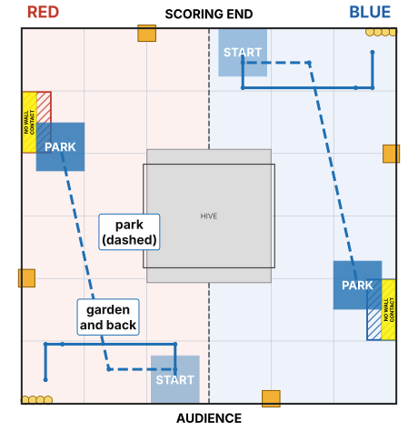
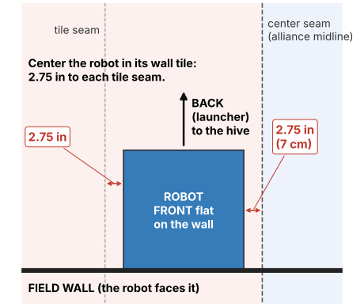

# Primary Shooter + Garden

**Our match auto when WE shoot first.** Driver Hub: Autonomous list, group **1 Match**.

The robot shoots its 4 pollen, drives to the garden corner to pick up more, comes back to the same
spot, shoots again if our cell is UP, then parks in the **INNER** slot. It knows where it is from
odometry the whole time.

## What the robot does

Times are from our practice on Nov 19 (7 runs).

| Time | What happens |
| --- | --- |
| 0 - 1 s | Launcher spins up. This first volley does **not** wait for the camera. |
| 1 - 4 s | Shoots its 4 pollen at our cell (the one that starts UP). Should tip it. |
| 4 - 7 s | Backs off the wall, slides toward the garden side. Launcher and agitator run 3 s more to empty the robot. |
| 7 - 11 s | Garden: slides to the side wall, then drives intake first into the garden wall. |
| 11 - 15.5 s | Drives back the same way to the start spot and squares up. Launcher spins up. |
| 15.5 - 22 s | Shoots again **only if** the camera sees our cell UP for over 1 s (our partner tipped the other cell). |
| 23.5 s | Leaves for the **INNER** slot. Parked by about 28.5 s. |

Points if it all works: LEAVE 3 + PARK 5, and 20 for every tip.

## Before the match

**1. Agree with the partner.** We shoot first. They shoot the other cell after our tip, stay out of
the garden lane until about 16 s, and park in the **OUTER** slot. Show them the partner sheet.

**2. Put the robot on the field** (same spot as Emergency Odo Shoot + Park).

- **Red:** at the **audience** wall. **Blue:** at the **scoring-end** wall.
- **Front** (intake) **flat on the wall**. The **back** (launcher and camera) **faces the hive**.
- **Center the robot on the hive.** Its edge is 3.7 in (9.5 cm) from the center seam.
- Exactly **4 pollen** loaded. Not touching a flower. Not in the loading zone.
- **Fresh battery.** Practice runs dropped to about 10 V during shooting.

**3. On the Driver Hub**, pick **Primary Shooter + Garden**.

**4. Press INIT. Then hands off.** The robot sets its position zero at INIT. If it gets bumped
afterwards, START is refused (`Pinpoint is away from the INIT zero`): press STOP, then INIT again.

**5. Pick the alliance, every INIT.** Row 1: D-pad **LEFT = RED**, **RIGHT = BLUE**.
Without it the Status says `BLOCKED` and the robot does nothing in auto.

**6. Check the screen:**

| Line | Should say |
| --- | --- |
| Status | `READY` |
| Row 1 Alliance | `RED audience-side cell (tags 34-37)` or `BLUE scoring-side cell (tags 42-45)` |
| BUILD / RUN | `pollen-hive-v40` / `MATCH / LIVE` |
| SETTINGS | `all defaults` (or only the change the coach asked for) |
| Hive cell behind robot | `Primary preload skips Hive UP` (not `NO CAMERA`) |
| Camera calibration | tilt and lens numbers (not `NOT CALIBRATED`) |
| Odometry | `READY` |

**7. Press START** when the match starts.

## Options (INIT rows, in screen order)

D-pad up/down = row, left/right = change, LB/RB = jump 5. **Triangle** = this row to default. **Circle** = all
route rows to default (keeps alliance and camera). **Square = save on the Hub for every later INIT:
only if the coach says.** There is no Execution row: every auto always runs LIVE.

| Row | Setting (default) | What it does |
| --- | --- | --- |
| 1 | Alliance (choose) | Which cell the camera watches. Every INIT. |
| 2 | Start delay s (0) | Waits before anything. Park time doesn't move, so it cuts the garden trip and 2nd shot. |
| 3 | Launcher ticks/s (1180) | Flywheel speed, steps of 20. Shots short: up. Long: down. |
| 4 | Match travel and park power (1.00) | Driving speed. Lower is gentler but may not finish. |
| 5, 6 | Beta first / second agitator feed s (3, 3) | Length of each volley. These are the Match values. |
| 7 | Beta garden total inward passes (1) | 2 = back off and push into the garden again, about 2 s more. |
| 8 | Park margin s (1.0) | Spare park time. More = safer park, less time for the 2nd shot. |
| 9 | Clear-out s after volley (3) | Launcher + agitator keep running to empty the robot. 0 = off. |

**Rows 10 to 56: leave alone.** Garden tuning, park and garden-entry points, measured park time
(5.46 s, don't lower), calibration-only rows, then the camera rows. A bad edit there can block INIT.

## If something is wrong

| You see | Do this |
| --- | --- |
| `BLOCKED: Choose alliance...` | Row 1: D-pad left (red) or right (blue). |
| `Pinpoint is away from the INIT zero` | Robot moved after INIT. STOP, INIT, hands off. |
| Odometry not `READY` | STOP, INIT, robot still. Still bad: **Emergency Timed Shoot + Park**. |
| `NO CAMERA` / `NOT CALIBRATED` | Still shoots the preload and parks; no 2nd volley. Check the Limelight USB (Hub blue port). |
| `CHANGED` the coach didn't ask for | Circle. Ask a programmer before Square. |
| Other `BLOCKED` | Programmer. Fallback: **Emergency Odo Shoot + Park** (same placement). |

**After the match:** check the video; tell a programmer the match number and anything odd. `STORAGE WARNING`
on screen: tell a mentor (the robot still runs).
