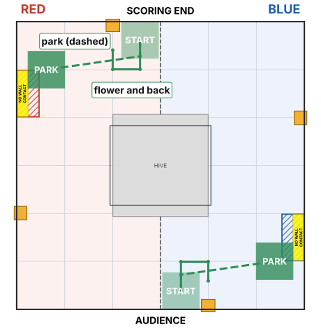
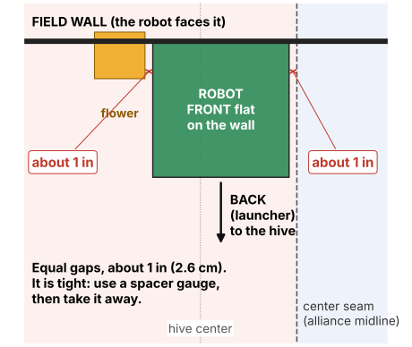

# Secondary Shooter + Flower

**Our match auto when our PARTNER shoots first.** Driver Hub: Autonomous list, group **1 Match**.

The robot waits until the camera sees our cell UP (the partner's tip does that), shoots its 4 pollen,
drains the flower beside it, comes back and shoots again right away, then parks in the **OUTER** slot.

## What the robot does

Times depend on when the partner tips. Practice, Nov 19 (2 runs):

| Time | What happens |
| --- | --- |
| from 0 s | Spins the launcher and **waits**. The camera watches our cell (it starts DOWN). |
| our cell UP for over 1 s | Shoots its 4 pollen (3 s). Practice: started at 1.7 s and 5.7 s. |
| next | Backs off the wall (about 14 in) and lines up with the flower. Launcher and agitator run 3 s more to empty the robot. |
| next 8 - 9 s | Flower: drainer down, drives in until seated, 2 side-to-side swings, backs out, 1 forward-back cleanup, intake on all the way. |
| about 19 - 21 s | Back at the start spot with the launcher already at speed. Shoots again as soon as it settles (about 0.3 s). **No camera wait:** our cell needs about 8 balls to tip, so it is still UP. |
| 25.5 s | Leaves for the **OUTER** slot. Parked by about 28.7 s. |

**If the partner never tips:** it never shoots in auto. It waits until 25.5 s, then parks.
The 4 pollen are still in the robot for TeleOp. **A late tip** (after about 8 s) may leave no time
for the second volley.

## Before the match

**1. Agree with the partner.** They shoot first and tip **as early as they can**, stay off our flower
lane, and park in the **INNER** slot. Show them the partner sheet.

**2. Put the robot on the field** (same spot as Emergency Odo Supporting Shooter).

- **Red:** at the **scoring-end** wall. **Blue:** at the **audience** wall.
- **Front** (intake) **flat on the wall**. The **back** (launcher and camera) **faces the hive**.
- **Between the flower and the center seam, same gap both sides: about 1 in (2.6 cm).**
  Use a spacer gauge, then take it off the field.
- Exactly **4 pollen** loaded. **Not touching the flower.** Not in the loading zone.
- **Drainer up**, servo plugged in. **Fresh battery.**

**3. On the Driver Hub**, pick **Secondary Shooter + Flower**.

**4. Press INIT. Then hands off.** If the robot gets bumped after INIT, START is refused
(`Pinpoint is away from the INIT zero`): press STOP, then INIT again.

**5. Pick the alliance, every INIT.** Row 1: D-pad **LEFT = RED**, **RIGHT = BLUE**.

**6. Check the screen:**

| Line | Should say |
| --- | --- |
| Status | `READY` |
| Row 1 Alliance | `RED scoring-side cell (tags 30-33)` or `BLUE audience-side cell (tags 38-41)` |
| BUILD / RUN | `pollen-hive-v40` / `MATCH / LIVE` |
| SETTINGS | `all defaults` (or only the change the coach asked for) |
| Hive cell behind robot | Our cell's name and **DOWN** (it starts down). Not `NO CAMERA`, and not UNKNOWN for long. |
| Camera calibration | tilt and lens numbers (not `NOT CALIBRATED`) |
| Odometry | `READY` |

**7. Press START** when the match starts. Sitting still at first is correct.

## Options (INIT rows, in screen order)

D-pad up/down = row, left/right = change, LB/RB = jump 5. **Triangle** = this row to default. **Circle** = all
route rows to default (keeps alliance and camera). **Square = save on the Hub for every later INIT:
only if the coach says.** There is no Execution row: every auto always runs LIVE.

| Row | Setting (default) | What it does |
| --- | --- | --- |
| 1 | Alliance (choose) | Which cell the camera watches. Every INIT. |
| 2 | Launcher ticks/s (1180) | Flywheel speed, steps of 20. |
| 3, 4 | Beta flower left-right / forward-back cycles (2, 1) | More gets more pollen out; about 1.4 / 1 s each. |
| 5 | Match collection entry left cm (-34.06) | Lines the drainer up with the flower. Only with a programmer, after a miss. |
| 6 | Match travel and park power (1.00) | Driving speed. |
| 7, 8 | Beta first / second agitator feed s (3, 3) | Length of each volley. These are the Match values. |
| 9 | Park margin s (1.0) | Spare park time. |
| 10 | Clear-out s after volley (3) | Launcher + agitator keep running to empty the robot. 0 = off. |
| 11 | Start delay s (0) | Not needed: it already waits for the tip. |

**Rows 12 to 64: leave alone.** Flower tuning (insertion 24 cm, swing size 3.5 cm and power 0.75
first), park points, measured park time (3.47 s, don't lower), calibration-only rows, then the
camera rows. A bad edit there can block INIT.

## If something is wrong

| You see | Do this |
| --- | --- |
| `BLOCKED: Choose alliance...` | Row 1: D-pad left (red) or right (blue). |
| `...requires servo pollenDrainer` | Drainer servo unplugged or not configured. Fix, or **Emergency Odo Supporting Shooter**. |
| `Pinpoint is away from the INIT zero` | Robot moved after INIT. STOP, INIT, hands off. |
| Odometry not `READY` | STOP, INIT, robot still. Still bad: **Emergency Timed Supporting Shooter**. |
| `NO CAMERA` / `NOT CALIBRATED`, or hive line stuck on `UNKNOWN` | **It will not shoot.** Check the Limelight USB (Hub blue port). Can't fix: **Emergency Odo Supporting Shooter** (shoots on a timer). |
| `CHANGED` the coach didn't ask for | Circle. Ask a programmer before Square. |

**After the match:** check the video; tell a programmer the match number and anything odd. `STORAGE WARNING`
on screen: tell a mentor (the robot still runs).
