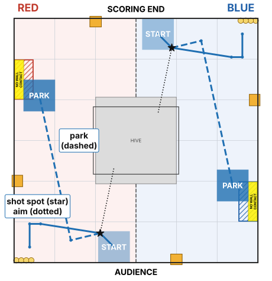
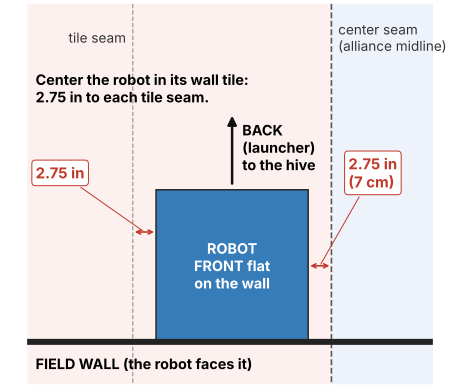

# Beta Primary Shooter - Angled Left

**Beta test: Primary Shooter + Garden, shot from an angle.** Driver Hub: Autonomous list, group **2 Beta Test**.
Same start, garden trip and park slot as the match Primary. The difference: both volleys are shot from a
spot off the wall and to the left (toward the garden), turned to aim at our cell.

## What the robot does

One practice run (Nov 19, v36); later builds untested on the field.

| Time | What happens |
| --- | --- |
| 0 - 1.2 s | One straight leg to the spot: 8 in off the wall, 10.5 in left. Launcher spins up on the way. |
| 1.2 - 2 s | Turns in place to the **calculated** aim, about 18.5 deg right (it points the launcher, which is left of the robot's center). |
| 2 - 5 s | Shoots its 4 pollen. Does not wait for the camera. |
| 5 - 11 s | Straight to the garden, picks up, like the match Primary. |
| 11 - 14 s | Back to the same spot; turns to the same aim. |
| then | Shoots again **only if** the camera sees our cell UP. |
| 23.5 s | Leaves for the **INNER** slot from the spot. |

**Aiming is by odometry, not the camera:** the angle comes from where the robot started, the spot and
the aim target rows. The camera only stops the second volley when our cell is not UP.
On Nov 19 the camera never saw our cell from the spot, so the second volley never fired. Check the
camera from the spot before counting on it.

## Before the match

**1. Agree with the partner.** Same as the match Primary: we shoot first; they park OUTER and stay out of
the garden lane. Our robot also uses the space 8 in off the wall in front of the start.

**2. Put the robot on the field** (same spot as the match Primary).

- **Red:** at the **audience** wall. **Blue:** at the **scoring-end** wall.
- **Front** (intake) **flat on the wall**, **back** (launcher and camera) **to the hive**.
- **1 in (2.5 cm) from the center seam** (spacer gauge, then take it off the field): the launcher
  is on the hive's center. INIT row 2 says 1.00. The aim is calculated from this spot, so
  placement matters more than in the match Primary.
- Exactly **4 pollen**. **Fresh battery.**

**3.** Pick **Beta Primary Shooter - Angled Left**. **4. INIT, then hands off.** **5. Row 1:** D-pad **LEFT = RED**, **RIGHT = BLUE**.

**6. Check the screen:**

| Line | Should say |
| --- | --- |
| Status | `READY` |
| Row 1 Alliance | `RED audience-side cell (tags 34-37)` or `BLUE scoring-side cell (tags 42-45)` |
| Row 2 Start gap to center seam in | `1` (matches where the robot really is) |
| BUILD / RUN | `pollen-hive-v43` / `MATCH / LIVE` |
| Plan | `PRIMARY ANGLED: drive to 8.0 in away / 10.5 in left, turn -18.5 deg, ...` |
| SETTINGS | `all defaults` (or only the change the coach asked for) |
| Odometry | `READY` |

**7. Press START** when the match starts.

## Options (INIT rows, in screen order)

D-pad up/down = row, left/right = change, LB/RB = jump 5. **Triangle** = this row to default. **Circle** = all
route rows to default (keeps alliance and camera). **Square = save on the Hub for every later INIT** (its own
saved file, separate from the match Primary). No Execution row: it always runs LIVE.

| Row | Setting (default) | What it does |
| --- | --- | --- |
| 1 | Alliance (choose) | Which cell the camera watches. Every INIT. |
| 2 | **Start gap to center seam in** (1.00) | Where the robot starts: its edge this far from the center seam. The aim and the garden and park points use it. |
| 3 | Start delay s (0) | Waits before anything. |
| 4 | Launcher ticks/s (1180) | Flywheel speed, steps of 20. |
| 5 | Match travel and park power (1.00) | Driving speed. |
| 6, 7 | Beta first / second agitator feed s (3, 3) | Length of each volley. |
| 8 | Beta garden total inward passes (1) | 2 = push into the garden again, about 2 s more. |
| 9 | Park margin s (1.0) | Spare park time. |
| 10 | Clear-out s after volley (3) | Launcher + agitator keep running to empty the robot. 0 = off. |
| 11 | **Angled shot spot left in** (10.5) | Where to shoot from: inches left of the start (toward the garden). Negative = right. |
| 12 | **Angled shot spot away from wall in** (8) | Where to shoot from: inches off the end wall (3 to 24). |
| 13 | **Aim target in left of center** (-2.0) | Where on the cell to aim, inches left of its middle; -2 = 2 in right (the robot shoots a little left). 0.5 in steps. |

The Plan line shows the turn the robot will make after any change to rows 2 and 11-13. A spot whose
turn would hit the wall, or the midline, blocks INIT.

**Rows 14 to 60: leave alone.** Garden tuning, park and entry points, calibration-only rows, camera rows.

## If something is wrong

Same as the match Primary page. Plus: if the second volley never fires, the camera may not see our cell
from the spot; tell a programmer. Fallback: **Primary Shooter + Garden**.
