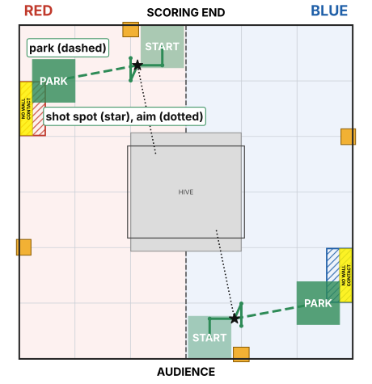
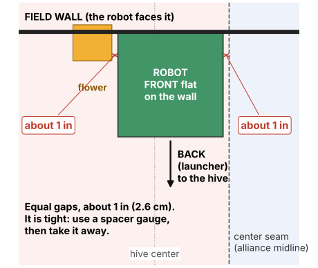

# Beta Secondary Shooter - Angled

**Beta test: Secondary Shooter + Flower, shot from an angle.** Driver Hub: Autonomous list, group **2 Beta Test**.
Same start, flower trip and park slot as the match Secondary. The difference: both volleys are shot from
a spot off the wall and to the right (toward the flower side), turned to aim at our cell.

## What the robot does

**Not yet run on the robot.** Times are estimates.

| Time | What happens |
| --- | --- |
| 0 - about 2 s | Straight off the wall 8 in (clear of the flower), then 10.5 in right to the spot. Launcher spins up. |
| next | Turns in place to the **calculated** aim, about 4.6 deg left (it points the launcher, which is left of the robot's center). |
| our cell UP for over 1 s | Shoots its 4 pollen (3 s). The camera only decides **when**, not where. |
| next | Straight to the flower, drains it like the match Secondary. |
| then | Back to the same spot, same aim. Shoots again **right away**: our cell needs 8 balls to tip, so it is still UP. |
| 25.5 s | Leaves for the **OUTER** slot straight from the spot. |

**Aiming is by odometry, not the camera:** the angle comes from where the robot started, the spot and
the aim target rows. The camera is used only to wait for our cell UP before the first volley.
**If the partner never tips:** it never shoots in auto, waits at the spot, and parks at 25.5 s.

## Before the match

**1. Agree with the partner.** Same as the match Secondary: they shoot first and tip as early as they can,
then park INNER. Our robot also uses the space 8 in off the wall in front of the start and the flower.

**2. Put the robot on the field** (same spot as the match Secondary).

- **Red:** at the **scoring-end** wall. **Blue:** at the **audience** wall.
- **Front** (intake) **flat on the wall**, **back** (launcher and camera) **to the hive**.
- **Equal 1 in gaps** to the flower and the center seam (spacer gauge, then take it away). The
  aim angle is calculated from this spot.
- Exactly **4 pollen**. **Drainer up**, servo plugged in. **Fresh battery.**

**3.** Pick **Beta Secondary Shooter - Angled**. **4. INIT, then hands off.** **5. Row 1:** D-pad **LEFT = RED**, **RIGHT = BLUE**.

**6. Check the screen:**

| Line | Should say |
| --- | --- |
| Status | `READY` |
| Row 1 Alliance | `RED scoring-side cell (tags 30-33)` or `BLUE audience-side cell (tags 38-41)` |
| BUILD / RUN | `pollen-hive-v46` / `MATCH / LIVE` |
| Plan | `SECONDARY ANGLED: drive to 8.0 in away / -10.5 in left, turn 4.6 deg, ...` |
| SETTINGS | `all defaults` (or only the change the coach asked for) |
| Hive cell behind robot | Our cell's name and **DOWN** (it starts down). Not `NO CAMERA`. |
| Odometry | `READY` |

**7. Press START** when the match starts. Moving to the spot right away is correct.

## Options (INIT rows, in screen order)

D-pad up/down = row, left/right = change, LB/RB = jump 5. **Triangle** = this row to default. **Circle** = all
route rows to default (keeps alliance and camera). **Square = save on the Hub for every later INIT** (its own
saved file, separate from the match Secondary). No Execution row: it always runs LIVE.

| Row | Setting (default) | What it does |
| --- | --- | --- |
| 1 | Alliance (choose) | Which cell the camera watches. Every INIT. |
| 2 | Launcher ticks/s (1180) | Flywheel speed, steps of 20. |
| 3, 4 | Beta flower left-right / forward-back cycles (2, 1) | More gets more pollen out; about 1.4 / 1 s each. **Forward-back 0 = flower drain off:** after its shot the robot stays at its shooting spot until park time, then parks. |
| 5 | Match collection entry left cm (-34.06) | Lines the drainer up with the flower. Only with a programmer, after a miss. |
| 6 | Match travel and park power (1.00) | Driving speed. |
| 7, 8 | Beta first / second agitator feed s (3, 3) | Length of each volley. |
| 9 | Park margin s (1.0) | Spare park time. |
| 10 | Clear-out s after volley (3) | Launcher + agitator keep running to empty the robot. 0 = off. |
| 11 | Start delay s (0) | Not needed: it already waits for the tip. |
| 12 | **Angled shot spot left in** (-10.5) | Where to shoot from: inches left of the start; negative = right, toward the flower side. |
| 13 | **Angled shot spot away from wall in** (8) | Where to shoot from: inches off the end wall (3 to 24). Under 5 in hits the flower. |
| 14 | **Aim target in left of center** (-2.0) | Where on the cell to aim, inches left of its middle; -2 = 2 in right (the robot shoots a little left). 0.5 in steps. |

The Plan line shows the turn the robot will make after any change to rows 12-14. A spot that would
cross the midline, hit the flower or the wall blocks INIT.

**Rows 15 to 67: leave alone.** Flower tuning, park points, calibration-only rows, camera rows.

## If something is wrong

Same as the match Secondary page. Fallback: **Secondary Shooter + Flower**.
